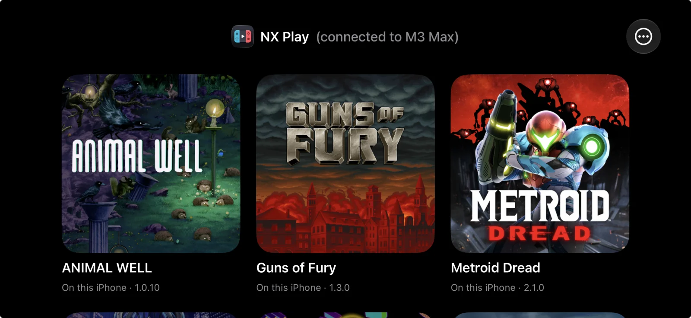
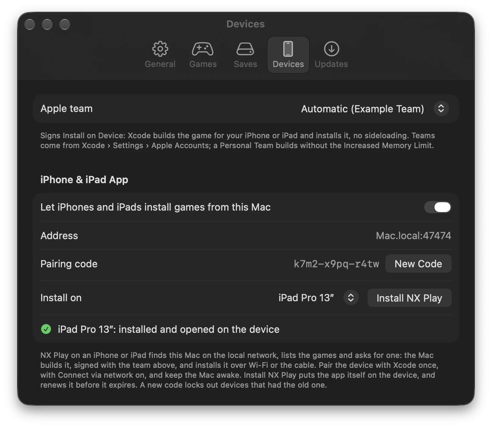

# Changelog

User-visible changes to NX Play, `nxplay` and the setup. The format follows [Keep a Changelog](https://keepachangelog.com).

## Unreleased

## 1.8.11 — 2026-11-11

### Changed

- **Console Mode's game details fade out at the bottom** while there's more below, as they do at the top. The screenshot row was cut straight across there and looked cropped; Down still brings the whole row into view. (Issue #25)
- **A game's app gets the store's icon through nxnative's own `--fallback-icon`**: nxnative gives it only when the game has no icon of its own, from its update or its base game, instead of NX Play guessing from the extracted files. A game that hasn't been extracted yet when it's packed gets it too. A game pinned to an older nxnative checkout keeps the way before.

### Fixed

- **With cloud saves on, a play whose cloud save can't be read** (offline, or iCloud couldn't download it) no longer waits another 10 seconds for it once the game starts. NX Play tells nxnative the cloud wasn't read, as nxnative's front-end guide now asks, and as before neither save is replaced when both changed: the next Play asks.

## 1.8.10 — 2026-11-11

### Added

- **Artwork for Switch 2 games:** the community list NX Play takes the eShop's artwork and details from has no Switch 2 games, so they had no banner, icon, description or screenshots. A game the list lacks now gets them from its page on Nintendo's US store, which also covers Switch games newer than the list. A game whose files have no icon of its own (one packed from a `.nup` may not) shows that icon in the library and behind Console Mode, and its Mac app, iPhone app or device install gets it as its app icon. (Issue #24)

## 1.8.9 — 2026-11-11

### Changed

- **Settings resizes:** drag the Settings window's edge to make it taller or shorter; every tab scrolls in the height you give it, and Settings opens at that height next time. Its width stays as it was.

### Fixed

- **Settings no longer crashes:** NX Play 1.8.8 crashed on switching to another Settings tab, General to Devices or any other, as the window resized itself over and over to fit the tab.

## 1.8.8 — 2026-11-10

### Added

- **60 or 120 fps for games nxnative has no profile for:** nxnative's **Frame rate** comes only with a game it has tested, so a game without a profile runs at the rate it asks for, often 30. Game Settings now offers such a game **Frame rate (untested)**: 60 fps, or 120 fps on a Mac with a 120 Hz screen, a frame each display refresh. That's right for a game that keeps time by the clock (Wreckfest) and too fast for one that counts frames, so it's each game's own choice, and the game's own rate by default.

### Changed

- **Setup no longer installs .NET:** nxnative's game extractor and shader translator are native programs now, so Setup's Install Missing no longer installs the .NET SDK or asks for your password for it. Setup asks for .NET only while your nxnative is older than that change. **Uninstall NX Play…** still offers to remove a .NET SDK Setup installed before.

### Fixed

- **Settings fit a small screen:** a tab taller than the screen, such as General, now scrolls, so its last settings are no longer out of reach under the Dock.

## 1.8.7 — 2026-11-10

### Added

- **Free Up Space removes shader compile caches** ([#21](https://github.com/varyform/nx-native-wrapper/issues/21)): a build's `shader/cache/cas.db` keeps the compiled shaders of every nxnative version that changed them, and can reach tens of GB. Games play without it. The next rebuild compiles the shaders again.

- **Old device install copies are removed** ([#22](https://github.com/varyform/nx-native-wrapper/issues/22)): for each device, Xcode's device service keeps a copy of the app it installed, as big as the game, on the Mac's own disk. It also keeps the copies of older builds of the game. After each Install on Device, NX Play now removes the older ones, and Free Up Space lists every game's copies. Both need Full Disk Access for NX Play, since macOS opens that folder only to apps with it. Free Up Space's **Give Access…** opens System Settings at Full Disk Access, with NX Play's icon beside it to drag into the list.

### Fixed

- **Game Controls lists the right stick** ([#22](https://github.com/varyform/nx-native-wrapper/issues/22)): the arrow keys with Shift held move it, which the window didn't say.

## 1.8.6 — 2026-11-09

### Added

- **Several games folders** ([#20](https://github.com/varyform/nx-native-wrapper/issues/20)): Settings › General › Games Folders takes more than one folder, and their games show as one library. A folder can also be a single game's own folder. Builds and saves stay where they are, so nothing rebuilds. A folder on a disk that isn't connected is marked as such, and its games come back when it's mounted. The window title is now always NX Play, and **Choose Games Folder…** is **Add Games Folder…**.

- **Play asks which save to use when the cloud's and this Mac's both changed:** with cloud saves on, a game played on two devices without a sync in between no longer simply takes the newer save. Play shows when each was saved and on which device, and the other is kept in the save's backups. It needs a game built with a recent nxnative.

- **Press a button to join:** with this nxnative setting on (Settings › Games › Controllers, next to Players), a controller becomes a player at its first button press, so players choose who is player 1. It shows once a game built with a recent nxnative offers it, and the controller list says how players join while it's on.

- **A build that finishes without part of what it makes says so:** the log panel shows "done, with a warning" in orange, and the step's line in the log is orange too. nxnative now packs a Mac app or an IPA even when its pipeline archive fails, and that app builds the pipelines on its first start.

- **Keep only the unpacked copy of NSZ and XCZ games:** nxnative unpacks a compressed game into its build folder and keeps both copies. With this new setting (Settings › General), once a game is built for the Mac, the unpacked NSP or XCI moves into the game folder and the NSZ or XCZ goes to the Trash, so the game takes its space once and is never unpacked again. Turning it on offers to tidy the games built already. It's off by default, since it changes your own files.

## 1.8.5 — 2026-11-08

### Added

- **Games on their own nxnative checkout are marked:** a game whose folder links to its own nxnative checkout gets a purple branch badge, with the checkout and its branch in the tooltip, and Console Mode names the branch. A link that isn't a checkout gets an orange badge, since that game builds with the shared checkout.

- **Sort and filter the library:** a toolbar menu (also View › Sort By and View › Show) orders the grid and the list by name, last played or date added, and can show only Switch or Switch 2 games, the games that need attention, or kept builds. The list gets Last Played and Added columns, and its headers now sort the grid too.

### Changed

- **A card's badges fit however many a game has:** App, Xcode and IPA are icons now, all badges are one height, and the ones that don't fit on a narrow card collapse into a "+N" whose tooltip names them. Switch 2 moved off the artwork to the end of the line under the title, in red.

### Fixed

- **A controller can see what it picks in Play's questions outside Console Mode:** "Update first?" and the save question highlighted the controller's row only in Console Mode, so in the window A answered a row nobody could see. With a controller connected, the window shows the row and the button that backs out too.

- **Two copies of the same game no longer share one "new in nxnative" badge:** the badge, the list of nxnative's changes and nxnative Notes went by the game's title ID, so a freshly rebuilt copy could show the changes an older copy hadn't had yet. Each folder now shows its own, and a copy pinned to its own nxnative checkout no longer lends its notes to the other.

## 1.8.4 — 2026-11-07

### Added

- **A game can build with its own nxnative checkout:** a `nxnative` link in the game's folder pins it to a checkout anywhere — a fork or a branch, or a worktree of the same clone (`ln -s <checkout> "<game folder>/nxnative"`). Extracts, plays, rebuilds, IPAs, Mac apps, device installs, the settings list, the game's badges and its nxnative Notes all use it. nxnative updates pull that checkout, so a branch with no upstream stays frozen. The job's log says which checkout a game used, or that it ignored a link that isn't a checkout.

- **Game › Open Cheats Folder** opens a built game's cheats folder (`<title ID>_build/cheats`), so you can put a downloaded `<build ID>.txt` there. It loads the next time the game starts.

- **NX Play for iPhone and iPad supports iPhone Duo:** the library keeps its tiles on either side of the fold, folded or flat. Installing the app again from the Mac brings this to the device.

### Changed

- **NX Play uses less memory, and loads game icons in the background:** icons are kept at the size they're shown. After scrolling through a library of about 40 games, the app used 148 MB instead of 257 MB.

### Fixed

- **Install on Device and Install NX Play work on a device new to your Apple team:** the signing profile stopped at the devices it was made for, so a newer device refused the app with "This provisioning profile cannot be installed on this device". NX Play now adds the device to the profile with one extra build, once for each game. Keep the device unlocked for that step.

- **Game names no longer show as garbage when the control data compresses its titles:** NACPs from newer SDKs (repacks like Breath of the Wild's, Mario 1.2.1) deflate the language entries; they showed as mojibake in the library, the list and Console Mode.

- **Removing a build no longer deletes a game's cheats:** Free Up Space keeps the cheat files and your choices of which are on, like the saves, and so does Remove Game unless you also remove the saves.

- **Console Mode describes every build step in plain words:** building from a NUP or a dump, the new check of a game's files, and a few other steps showed nxnative's own names, such as `unpack v131072`.

## 1.8.3 — 2026-11-05

### Added

- **More layouts of a Switch 2 dump**, now that nxnative builds them: `exefs/` and `romfs/` directly in the game's folder, as `nup extract` writes them, a dump with only `updates/<version>/`, and a base game whose RomFS is in its update. NX Play didn't list these before.

### Changed

- **A Switch 2 game with no nxnative profile can now be built**: nxnative guesses a profile for a NUP or a dump, as it does for an NSP, instead of refusing it. Its red **No profile** badge is now the grey **Guessed** one. Such a game may still not boot.

## 1.8.2 — 2026-11-04

### Added

- **Switch 2 games from a NUP file** ([#12](https://github.com/varyform/nx-native-wrapper/issues/12)): a game folder can hold one `.nup` file, which nxnative now builds with no `prod.keys`. NX Play lists it, reads its title ID from the file, and builds and plays it, with the same **Switch 2** and **No profile** badges as a dump. Free Up Space and Remove Game treat the `.nup` like an NSP.

### Fixed

- **NSPs beside a dump of the same game**: nxnative builds the NSPs then, and those need `prod.keys`. NX Play treated the folder as a dump: it didn't check for the keys, and could show **No profile**.

## 1.8.1 — 2026-11-03

### Added

- **Switch 2 games**: a game folder can hold a dump of the game's files in place of NSPs, the way nxnative builds a Switch 2 game: `base/exefs`, `base/romfs`, and optionally `updates/<version>/` and `dlc/<title ID>/`. NX Play lists it, reads its title ID from `main.npdm`, and builds and plays it like any other game, with no `prod.keys`. A **Switch 2** badge marks Switch 2 games. nxnative builds a dump only for a game it has a profile for (Donkey Kong Bananza, Splatoon Raiders and Fire Emblem Fortune's Weave so far), so a **No profile** badge marks the others; Extract tries again with nxnative's latest code. Remove Game deletes the dump's `base`, `updates` and `dlc` folders with the rest.

### Changed

- **Don't Play is a row in Play's questions** ([#9](https://github.com/varyform/nx-native-wrapper/issues/9)): asking whether to update first, or which save to use, Console Mode's controller can now move down to **Don't Play**, under the answers, and press A. The row shows the button that does the same from anywhere (B, or Esc). Before, it was a button the controller couldn't reach, and nothing on screen said B cancels.

## 1.8.0 — 2026-11-02

### Added

- **NX Play for iPhone and iPad**: a launcher that lists the Mac's games, asks the Mac to install one, and plays the installed ones. The Mac builds the game and installs it on the device over Wi-Fi, or over the cable when the device is plugged in. On the Mac, turn on Settings › Devices › iPhone & iPad App and click **Install NX Play**. Then pair the device with the code Settings shows; **New Code** replaces the code. On the device:
  - The header shows NX Play's icon and which Mac it's connected to.
  - A controller can drive it.
  - It says when a game's signature runs out (7 days with a Personal Team). **Renew** installs the expiring games again.
  - It notices a game you deleted from the home screen when you come back to it, or when you pull down to refresh, and marks it **Removed from this iPhone** (or iPad). One tap reinstalls it.
- **Games installed on a device open from NX Play for iPhone and iPad**: nxplay gives each one a URL scheme, `nxplay-<title ID>`. Reinstall a game installed before this once.

### Changed

- **NX Play's own log lines are blue too**, like nxplay's since 1.7.16: the save backup's commits and pushes, the command each run starts with, and how it ended (done, failed, cancelled).

## 1.7.16 — 2026-11-01

### Added

- **Play asks before updating a game** ([#7](https://github.com/varyform/nx-native-wrapper/issues/7)): when nxnative has new code for a game's build, Play no longer rebuilds right away. It says what the update brings: how many new commits, which ones are for this game, whether every shader is translated again, and how long the last update took, the Mac app included. Then it asks: **Update Now**, or **Play Current Build** to play straight away. Playing the current build leaves nxnative where it was, so the other games don't fall behind. In Console Mode the controller answers. Settings › General can always update first, as before, or always play the current build. Rebuild and Update All Builds still take the latest code.

### Changed

- **NX Play's own lines in the log are blue**, so they stand apart from nxnative's output: which save a play uses, the game settings it passes, nxnative updates, rebuilds and the like. `nxplay` in a terminal does the same; set `NO_COLOR` to turn it off.

### Fixed

- **Play asks which save to use when the Mac app has its own** ([#8](https://github.com/varyform/nx-native-wrapper/issues/8)): a Mac app opened from Finder before NX Play shared its save keeps a save of its own. Play used to start the app with NX Play's save without saying so, so progress made in the app looked gone. While the two saves differ, Play now asks: **NX Play's save**, **the Mac app's save**, or **the newer one**. Nothing is copied or deleted; the other save stays as it is. Tick **Don't ask again** to keep the answer for the game, and use **Ask Again** in Game Settings to undo it. In Console Mode the controller answers. The log now names the save each play uses.

## 1.7.15 — 2026-11-01

### Fixed

- **"App out of date" right after Update Mac App:** an app packed after nxnative updated, but before the game was rebuilt, runs newer code than the build, yet NX Play called it out of date. It now counts as up to date, and Play opens it.

## 1.7.14 — 2026-11-01

### Changed

- **A rebuild keeps the Mac app up to date** ([#6](https://github.com/varyform/nx-native-wrapper/issues/6)): when an nxnative update rebuilds a game that has a Mac app, the app is packed again with the new code. That adds a couple of minutes to the rebuild, and Play keeps opening the app instead of falling back to the build. This covers Rebuild, Update All Builds and a rebuild before Play, but not kept builds. When an app is out of date anyway, for example because the game files were removed or the packing failed, an orange **App** badge and a pill in Console Mode say so, and the Game menu's **Update Mac App** packs it again.

## 1.7.13 — 2026-11-01

### Added

- **Play opens the game's Mac app** when it has one ([#6](https://github.com/varyform/nx-native-wrapper/issues/6)), so the Dock shows the game's name and icon instead of "dmhost". The app plays with the game's save and cheats from its folder, so your progress carries over, and with NX Play's game settings. An app packed with older nxnative code than the game's current build isn't used until Make Mac App packs it again; Play uses the build meanwhile. Games without an app play as before.

- **The Mac app shares the save when opened from Finder too:** NX Play points it at the game's save through the app's `env.txt`. An app that already has a save of its own keeps it, and the log says so. Turn on cloud saves in NX Play and in the app's settings window to keep the two in step.

- **Free Up Space removes Mac apps:** the apps Make Mac App packed into game folders are listed under **Mac apps**, and removing one takes nxnative's `.app.key` beside it too. An app is made of APFS clones of its build, so Finder may show it at several GB while deleting it frees much less, such as 30 MB for a 4.9 GB app. The size listed is what deleting it actually frees. Make Mac App makes it again, and the app's own save stays.

## 1.7.12 — Stair Climber — 2026-10-31

### Changed

- **Console Mode shows which game is building:** a bright arc runs round its tile's border, and a pill at its foot says "Building 42%", or "Queued" for one waiting its turn. When that tile is off screen, a marker at that edge of the row shows the game's icon and progress, with an arrow pointing to it and nudging that way. Click it to select the game.

- Small text and animation tweaks in Console Mode.

## 1.7.11 — 2026-10-30

### Added

- **Tools › Update All Builds…** brings every game up to date with nxnative, one build after another, so each one is ready when you want to play it. After an nxnative update a game's next build can take from a few minutes to an hour. After an Xcode update every game recompiles its graphics once. A game that's already current takes a few seconds. The window explains this two ways, and you pick one: **Gamer** compares it to the shader pre-caching Steam and consoles do after an update. **Old school** describes it as a make world with a cold compiler cache: nxnative's shader chain, and its cache of compiled shaders keyed by the Metal compiler. Kept builds and games without their game files are skipped. **Only while plugged in**, on by default, holds the next build while the Mac is on battery and starts it once you plug in. The status bar then says it's waiting for the power adapter.

### Changed

- **Controllers use the Switch's buttons in NX Play too:** on an Xbox or PlayStation controller, the right button now plays and the bottom one goes back, as A and B do once the game starts (nxnative maps them by position). Before, Console Mode used them the other way round. The hints show the button to press, such as Ⓑ on an Xbox controller. Pro Controllers and Joy-Con work as before.

- **Console Mode's build progress is a staircase:** one step per stage of the build. Finished steps are solid, and the current one fills as it goes, or pulses when its work can't be counted. A little stick figure climbs them. Its legs bend at the knee as it plants each foot on a step, its arms swing against its legs, and its body rises as it climbs. It walks to where the build is and runs to catch up after a jump. When the build stops moving, it paces its step, stops, looks around and taps a foot. It waves from the top when the build is done. With Reduce Motion it stands still. The line under it uses a player's words, such as "Step 8 of 9 · Preparing the graphics · 12,339/18,503 shaders · 15:33 left", instead of "8/9 Mac shaders · compiling". The library's status bar and log keep the build script's own words.

- **The Mac stays awake while a build runs,** so an overnight build no longer stops when the Mac goes to sleep. App Nap is off too, so a build in the background runs at full speed. The display can still sleep.

- **An update build on a game that's already built says "Building",** not "Extracting".

## 1.7.10 — 2026-10-30

### Added

- **Game settings, for all games and for each one:** the settings nxnative offers for each game, with the defaults it was tested with. Depending on the game: frame rate, render scale, docked or handheld, upscaling, language, window or full screen, rumble, and performance switches such as frame buffering and Metal 4 pipelines.
  - **Settings › Games** sets the values every game gets unless it has its own. It replaces the Playing tab: its language, full screen and HUD settings carry over, and the controllers are there too.
  - **Game › Game Settings…** (⌥⌘,) has one game's list, including settings only some games have, such as frame rate and render scale. Each one follows the global value until you change it.
  - Both look like the game's own settings window: switches, sliders with their percentage, and menus. The basic settings come first, the rest under Advanced settings. A changed value is tinted and has its own reset button.
  - A game that doesn't offer a global value keeps its tested default, and a game without the global language plays its regional twin. Settings apply at the game's next start, and the log lists the ones it used.
  - The game's Mac app shares a game's own values, so its settings window shows the same choices.
  - `nxplay` writes each game's list after a build, and NX Play asks it for any game still missing one. `nxplay --settings` writes the list for a game already built. A setting can also be given for one start: `DM_FPS_TARGET=30 nxplay <game folder>`.

- **Updates in Console Mode:** when an update is ready, a small "Update 1.8 ready" pill sits beside the logo in the top bar, and the hints show which button opens it. It never takes the focus. Press Y (U on the keyboard) or click the pill to see what's new, then A for **Restart to Update** or B for later.

### Changed

- **A gentler update reminder:** an update that has been waiting for three days or more says since when, and that Restart to Update takes only a few seconds. This shows in the library's banner and in Console Mode's pill.

- **Updates that can't install say why:** NX Play run from the DMG or from Downloads can't replace itself. Until now it failed quietly in Settings › Updates. Now a banner above the library asks you to move it into Applications, with **Show in Finder** and **Dismiss**. Problems that pass on their own, such as being offline, still stay in Settings.

## 1.7.9 — 2026-10-30

### Added

- **Remove Game…** (Game menu, ⌘⌫) deletes a game for good: its game files, its build, its IPAs and its Mac app. Anything else you keep in its folder stays, and the folder goes once it's empty. Its saves stay unless you also tick **Also remove its saves** and say why: you have a backup, or you don't need them. Kept saves wait in the folder; put the game files back and the game plays on from them. To confirm, type the phrase it shows, one of a few picked at random.

- **Free Up Space removes builds** ([#5](https://github.com/varyform/nx-native-wrapper/issues/5)): each game's `<title ID>_build` folder is listed with its size, and the next Play builds it again from the game files. Its saves stay, and so does when you last played it. A game whose game files are gone keeps its build, since that's how it still plays, and so does a kept build; a game's build and its game files can't be deleted together. A build can hold half a million files, so the window now lists everything at once and measures the builds and Xcode builds in the background, four at a time, each with a spinner until its size is in. Sizes are remembered between launches and measured again only once a folder changes, so the window fills in at once the next time.

- **Several controllers, several players:** every connected controller now drives NX Play and Console Mode, not only the last one connected, each with its own held direction. Console Mode's top bar shows each controller with its player number and battery. **Settings › Playing › Controllers** lists them with the player each one is in a game and chooses how players are given out: each controller a player of its own with the keyboard on player 1 (nxnative's default), the keyboard player 1 on its own with the controllers from player 2, or every controller player 1. NX Play passes the choice to each game it starts (nxnative's `DM_PAD_MERGE` and `DM_KBD_PLAYER`), and lights each controller's player lights to match while NX Play is in front.

## 1.7.8 — 2026-10-30

### Added

- **Game details in Console Mode:** press down (or click the game's name) and the banner and name slide up to show the game's eShop description, its facts (publisher, release date, players, genre, age rating, version) and its screenshots across the screen. Down scrolls the description, then moves to the screenshots: left and right choose one, and A (or a click) shows it full screen. Left and right on the description move to the next game. Up at the top, B or Esc close the details. Screenshots download the first time a game's details open.

### Changed

- **A game getting ready says so:** in the few seconds before a game starts or rebuilds, while `nxplay` checks nxnative for updates, the game's badge reads "Preparing…" instead of "Running", and Console Mode's footer shows "Preparing <game>" with a moving bar and what `nxplay` is doing, such as "nxnative: up to date" or "nxnative updated: 3 new commits, rebuilding". The library's status bar shows the same.

- **Console Mode shows more of the eShop page:** the game's tagline under its name, and its publisher and release year next to its version. Its tiles, the library's cards and list, and Free Up Space use the eShop's own icon once it's downloaded; it's sharper than the one in the game's files.

- **NX Play opens in the mode you left it in:** quit it in Console Mode and it opens in Console Mode next time, at the game you played last. Quit it in the library and it opens there.

## 1.7.7 — 2026-10-29

### Added

- **Cloud saves:** Settings › Saves can sync each game's save through iCloud Drive or a folder you pick, so the game's iPhone app plays on from the same save. Pick the same folder in the iPhone app's Cloud saves. This is nxnative's own sync: each game keeps one file, `<title ID>/save.dmsync`, which the game brings in when it starts and sends a few seconds after each save. When both sides changed, the newer save wins and the other is kept in the save's backups. A game picks the setting up at its next play; a build made before nxnative had cloud saves gets it when it rebuilds. A save made in the last seconds before you quit goes up at the game's next start.

- **How far nxnative has got with a game:** the badge in the top-left corner of a game's artwork now tells three cases apart. A green check means nxnative lists the game as tested. An orange hammer means its profile is still in bring-up, and hovering shows how far it has got, such as "on the Mac 3D World reaches World 1-1". A grey question mark means nxnative has no profile and guesses one. **Game › nxnative Notes…** (⌥⌘I) shows what nxnative writes about the game: its stage, the regression check's last green run, and the opening of the profile's notes, with a link to the full notes on GitHub.

- **Your games' fixes:** when nxnative has changed a game's profile since the game was built, a blue badge shows how many commits, and hovering lists them. NX Play checks nxnative for new commits about once an hour, without changing your copy, so the badge shows before you play. The commits are also in nxnative Notes. When a play pulls nxnative's update, the log lists that game's commits on their own, under "for this game:".

- **Search games:** the toolbar's search field (Edit › Find Games…, ⌘F) narrows the grid and the list to the games with every word you type in their name, title ID or folder name. Console Mode still shows every game.

- **Game artwork in Console Mode:** the selected game's official eShop banner fills the upper half of the screen edge to edge and fades into a dark, blurred copy of the game's cover, which fills the rest of the screen behind the games. The game's name sits over the banner's foot, with its badges: its state, how far nxnative has got with it, nxnative's new commits for it, Kept, its version and when you last played it. Games without a banner show just the blurred cover. The games row starts at the left and scrolls only when the selection would leave the screen. A build, such as a game rebuilding before it plays, shows its game, stage and percentage in the bottom-left corner, whichever game is selected. NX Play downloads the banners it doesn't have yet in the background, at launch and when a game is added, starting with the game Console Mode opens on. Each banner shows as soon as it arrives, and opening Console Mode tries the missing ones again. It looks them up by title ID in the community database [blawar/titledb](https://github.com/blawar/titledb), the same source NX2Apple uses, and takes the images only from Nintendo's image server. The banners stay in `~/Library/Caches/com.varyform.nxplay/Banners`.

### Changed

- **Console Mode hides the mouse pointer** when it opens and whenever the controller or the arrow keys move through it. Moving the mouse brings the pointer back.

## 1.7.6 — 2026-10-29

### Added

- **Known games are marked:** a green check in the top-left corner of a game's artwork (in the list, beside its other badges) means nxnative has a game profile for it. A game without one is packed from a profile guessed from its files, and may not boot. Hovering over a badge (the check, the lock of a kept build, IPA, Xcode) explains it again; the game's own tooltip used to cover theirs.

- **The changelog in the app:** Help › NX Play Changelog lists every release. When an update is ready, **What's New** beside Restart to Update shows what it changes since your version, every release you skipped included. The running version shows it, so it first appears for the update after this one.

### Fixed

- **Games with zstd-compressed code build:** games made with system 22.0.0 or later, such as Well Dweller, can store their code compressed with Nintendo's variant of zstd (ZBIC). nxnative decodes it with the `zbic` Python package, which setup didn't install, so the build stopped at the first step. Setup installs it now. NX Play shows the Setup banner once after this update, until Setup has run and added the package. When nxnative starts using another package, each play now names it in the log, with the command that adds it, before a build stops on it.

### Changed

- **A new app icon:** the two Joy-Cons joined as one controller around a play button, instead of a console with a screen. The colors are the same.

- **Controllers with a generic name show their kind:** an Xbox controller on a USB cable, which calls itself just "Controller", now shows as "Xbox Controller" in Console Mode. A controller with a name of its own still shows that name.

- **A game started from Console Mode returns to Console Mode when it quits,** whether with ⌘Q or a crash. Before, macOS brought forward the app you'd used last on the desktop. Console Mode now covers the screen on the desktop, with the menu bar and Dock hidden, instead of opening a full-screen Space of its own. A game that quits hands the screen back to the desktop, where Console Mode is now waiting.

- **The build's counts are back:** the progress text shows them, such as "4/6 shader split · splitting · 211,200/304,243 files · 69% · 0:04 left". The log again gets a line with the count every 30 seconds while a long stage runs, as before the switch to JSON progress. Each field of the build script's events is checked, so a field a later nxnative drops or changes only leaves that part out.

## 1.7.5 — 2026-10-28

### Added

- **About NX Play** now shows the copyright, who makes NX Play, and links: GitHub, Releases, Report a Problem, nxnative and the MIT License.
- **Uninstall NX Play also removes NX Play from the Dock** when you'd kept it there, so no icon pointing at the Trash stays behind. The Dock restarts for a moment to pick up the change.

### Changed

- **A build no longer makes its card taller:** its progress shows as a thin bar along the bottom of the game's artwork, and the badge shows the percentage ("Extracting · 64%"). The stage is in the card's tooltip. In the list, the bar sits beside the badge, so the row stays one line.
- Cards are a little wider at their narrowest: 180 points instead of 168, so the badge and the button fit side by side more easily. Their artwork now lines up with the section title, with the selection highlight reaching into the margin as in Photos, and the gap between artworks is even.
- **The log starts hidden for new users:** the status bar shows what's building, and a failed build opens the log on its game. If you already use NX Play, the log stays as you left it.
- **A status bar while the log is hidden** shows what's building: the game, its stage, the time left and Cancel. With several builds, it shows how many, how many are waiting, and their average progress. Click it to select the game, or show the log from it.
- **Build progress comes from nxnative's front-end interface:** the build script's `--progress json` events ([docs/frontends.md](https://github.com/seedds/nxnative/blob/main/docs/frontends.md)). NX Play no longer reads the text it prints for people. The progress bar, the card and the Dock follow exact stage fractions, and now also show the time left in a stage. The log shows the same lines as before. In a terminal, `nxplay` still shows the build's bar.

### Fixed

- **Updates retry opening the downloaded DMG** when macOS's disk service is briefly busy ("Resource temporarily unavailable"), and keep trying to detach it, so no image stays mounted.

## 1.7.2 — 2026-10-28

### Fixed

- **Uninstall NX Play no longer fails over Homebrew tools other software needs.** Removing the tools stopped the whole uninstall when Homebrew refused to remove one that other formulae depend on, such as zstd, which llvm, node and python use. Uninstall now removes only the tools nothing else needs, one at a time. It lists the others under Kept, with what needs them, and finishes even if one can't be removed.

## 1.7.1 — 2026-10-28

### Added

- **Check for Updates…** in the NX Play menu checks now and opens Settings › Updates to show the result.

- **Uninstall NX Play…** (in the NX Play menu) removes everything NX Play put on the Mac: `~/Library/Application Support/NX Play` with what Setup installed, the settings, caches and saved window state. The app goes to the Trash. A checkbox also removes the Homebrew tools Setup installs; it's off by default, since other software may use them. Your games folder (with the games, their builds and their saves), `prod.keys`, the save backup repository and Homebrew stay. It lists each item with its size first, and waits until no game or build is running.

### Changed

- **Settings has tabs:** General, Playing, Saves, Devices and Updates. With everything on one page, the window was taller than a laptop screen, and Check Now ended up behind the Dock.

## 1.7 — 2026-10-28

### Added

- **Download and set up from the app:** NX Play comes as a signed, notarized DMG. On first launch **Setup** (NX Play › Setup…) checks the Mac and Xcode, and **Install Missing** installs the Metal Toolchain, Homebrew's tools, Python with nxnative's packages, and nxnative itself. Homebrew is the one thing to install by hand. What Setup installs, apart from Homebrew's tools, goes into `~/Library/Application Support/NX Play`. A copy built from the source keeps using the checkout, as before.
- **Automatic updates** for the downloaded app: NX Play checks GitHub for a new release at launch and once a day, then downloads its DMG and checks it: the checksum GitHub publishes, the developer's signature, and notarization. The update installs when you quit, or now with **Restart to Update** (Settings › Updates, or the banner), which waits until no game or build is running. Copies built from the source update with `git pull` and `bin/install`.
- **Save backup to a private Git repository** (Settings): pick a clone of your own repository. While a game plays, NX Play copies its save into a folder named after the game and its title ID each time the game saves, then commits and pushes. It does this once more when the game quits. If another Mac pushed in the meantime, its commits are pulled in first. Pushing uses your own Git credentials, and each backup shows in the log.

### Changed

- **`bin/install` replaces a running NX Play safely.** It used to swap the app out from under a running game or build. Now it asks NX Play to quit once nothing is running in it (games, builds, Free Up Space deletions, save transfers), waits until it has, installs, and reopens it. Ctrl-C while it waits cancels the install and leaves NX Play open. NX Play 1.6 and older don't respond, so quit those by hand once.

### Fixed

- **A build no longer plays against files another build rewrote.** Install on Device, Build IPA and Make Mac App build in the same folder as the Mac build, and rewrite its patched game code and shader tables with the nxnative they run. If one of them pulled an nxnative update, the next Play skipped the rebuild and started the old Mac host with the new files. `nxplay` now records the nxnative code each Mac build was made with, in `start_mac.sh`, and rebuilds when the checkout's differs, whichever run pulled it. Builds made before this change don't have that record yet and pick it up at their next rebuild.
- **Keep This Build protects the build from those other builds too.** While a game is kept, Install on Device, Build IPA and Make Mac App are disabled, and `nxplay --ipa`, `--mac-app` and `--device` refuse to run. Turn off Keep This Build to use them.
- Console Mode keeps the game tiles in the middle of the screen. They used to jump up whenever a build's progress bar appeared under the selected game.

## 1.6 — 2026-10-27

### Added

- **Keep This Build** (Game menu and right-click menu): keeps a game that works from being rebuilt when nxnative updates, since an update can break a game that played fine. A lock badge marks it on the icon, and `nxplay` plays the kept build as it is, saying it does so without the new nxnative changes. Rebuild (`nxplay --rebuild`) still replaces it. It's a `keep` file in `<title ID>_build`.
- **Console Mode starts at the game you played last:** the carousel lists games by when you last played them, newest first, then the ones you haven't played yet by name. Below the title it shows when you last played the selected game. `nxplay` records the time when a game starts and when it ends, in `<title ID>_build/run/last_played`, so plays from the Terminal count too.
- **Progress on the Dock icon:** a bar along the bottom of NX Play's icon while extractions, rebuilds, IPAs or installs run (their average when there are several). A **!** badge marks a build that failed while NX Play was in the background, until you open it again.
- **Allow a Metal compiler nxnative didn't test** (Settings, and `nxplay --allow-other-metal`). nxnative now stops every build when Xcode's Metal compiler isn't the version it tested its shaders with, and a newer Xcode than that is common. The setting is off by default, as nxnative's. When a build stops for this reason, NX Play points to the setting, and `bin/setup --check` reports the mismatch.

## 1.5 — 2026-10-26

### Added

- **Console Mode** (toolbar, View › Console Mode ⇧⌘F, or a controller's Menu button): NX Play goes full screen with the games as a carousel of their artwork over a blurred backdrop of the selected one. It lists only the games ready to play, and shows the clock, the connected controller and its battery, and button hints in the controller's own symbols. Games started from it open full screen. B or Esc leaves it.
- **Start games in full screen:** a setting, and `nxplay --fullscreen` (nxnative's `DM_FULLSCREEN`).
- **Controller navigation** in the library and in Console Mode, with any controller macOS supports (Joy-Con, Pro Controller, Xbox, DualShock, DualSense, 8BitDo): the D-pad or left stick moves through the games, A plays or extracts, B backs out, Menu toggles Console Mode.
- **Game menu** in the menu bar with the selected game's commands, the same as its right-click menu, with shortcuts: Play or Extract ⌘↩, Stop or Cancel ⌘., Rebuild ⌘B, Transfer Saves ⇧⌘T, Show in Finder ⇧⌘R.
- **Xcode builds** in Tools › Free Up Space: the copy of the game that Install on Device keeps (`<title ID>_build/xcode-derived-data`, 5–10 GB for a big game). Deleting it only makes the next install slower.
- **Xcode badge** on the icon of games that have that build, next to the IPA badge.
- **List view** for the library, next to the grid (the toolbar switch, or View › as Grid ⌘1 / as List ⌘2). It shows one row per game with its icon, version, title ID, status and Play or Extract button. Like the grid, it has an Extracted section and a Not Extracted section with Extract All, each sortable by any column. The arrow keys move the selection, and double-click and the right-click menu work as on a card. NX Play remembers which view you chose.
- **Make Mac App** (and `nxplay --mac-app`): packs a standalone, double-clickable app of the game into its folder with nxnative's `--platform mac-app`, for the Dock or Launchpad. It's made of APFS clones, so it takes almost no extra space, and it keeps its own save in `~/Library/Application Support/nxnative`. An **App** badge marks games that have one, and the menus can open it or show it in Finder. NX Play itself still plays from the game folder.
- **Show or hide the log** with the toolbar button or View › Show Log (⇧⌘Y). The log opens by itself, on the failed game, when a build or game fails. NX Play remembers whether it's shown and how tall you dragged it.
- `bin/setup` downloads Xcode's Metal Toolchain when it's missing, since every build compiles shaders with it; `bin/setup --check` reports it.

- **Copying…** badge on a game while Finder is still copying it in, either the whole game folder or one of its files. Extract, Rebuild, Install on Device and Build IPA wait until the copy is complete, and the card updates by itself when it is.

### Changed

- Tools › Remove Game Files and Remove IPAs are now one window, **Free Up Space**. It lists every game's files of each kind, selectable one by one, per game or per kind. The full warning about game files shows only when they're selected.
- In the right-click menu, Stop and Cancel moved up next to Play.

### Fixed

- Transfer Saves with no paired device explains how to pair it with this Mac. It used to show every file as "Only on Mac".

## 1.0 — 2026-10-26

First public release.

### NX Play

- A library of the games in a folder, with their icons: extract them, play them on the Mac, rebuild them, Extract All. The selected game's output is shown live, in color.
- **Install on Device:** builds the game with Xcode, signed with your Apple team, then installs and starts it on an iPhone or iPad.
- **Build IPA** for sideloading, with an IPA badge on the game's icon.
- **Transfer Saves** between this Mac and a device. It compares the saves file by file, shows which one is newer, and keeps the replaced save in `run/save-backups`.
- **Tools › Remove Game Files / Remove IPAs** to free space. Game files go only for games built for the Mac, and only after typing "yes, I'm sure".
- Settings for the games folder, nxnative, `prod.keys`, the game language, the Apple team and the Metal performance HUD. **Game Controls** shows the keyboard controls.

### nxplay

- Builds a game once and starts it from the saved launcher afterwards, with `--build-only`, `--rebuild`, `--ipa`, `--device`, `--fps` and `--lang`.
- Updates nxnative before each run, lists the new commits, and rebuilds only when they change files. It also follows upstream force pushes when the checkout has no commits of its own.
- Repairs saved launchers after a game folder or nxnative moves.
- Keeps playing the existing build when a game's original files are gone, instead of failing to rebuild.

### Setup

- `bin/setup` installs everything in one go: Homebrew tools, nxnative's Python packages in a project `.venv` with uv, and a clone of nxnative. Then it builds and installs the app. `--check` only reports what is missing.
