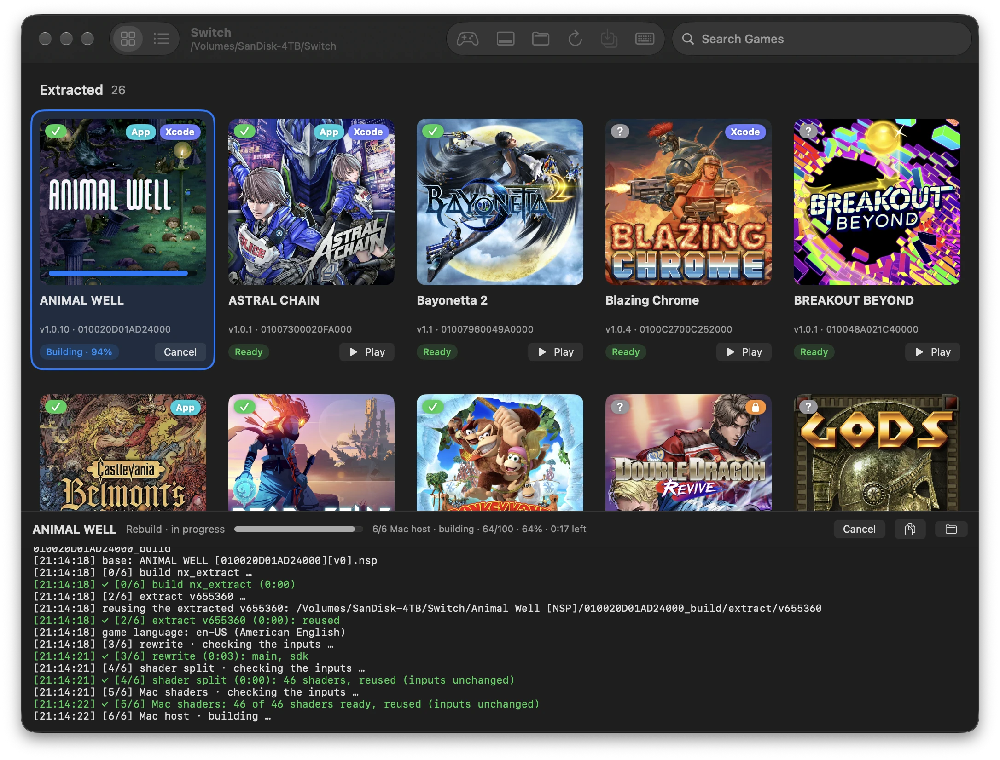
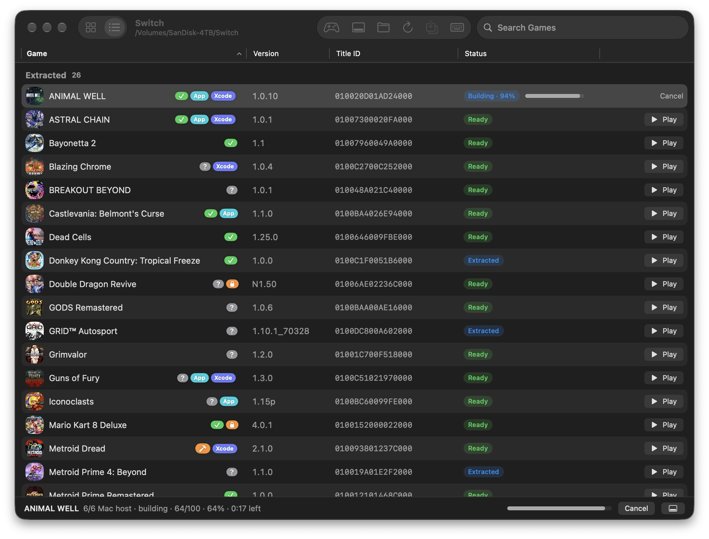
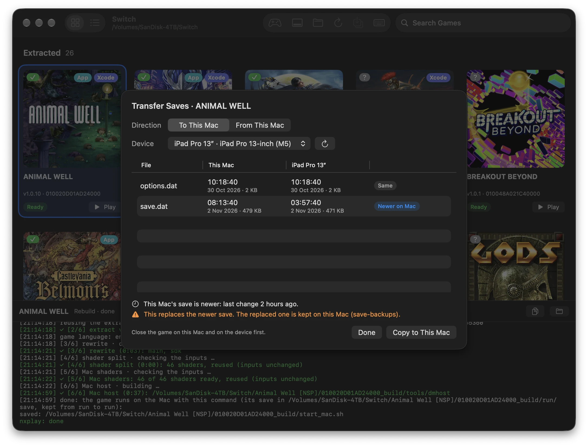
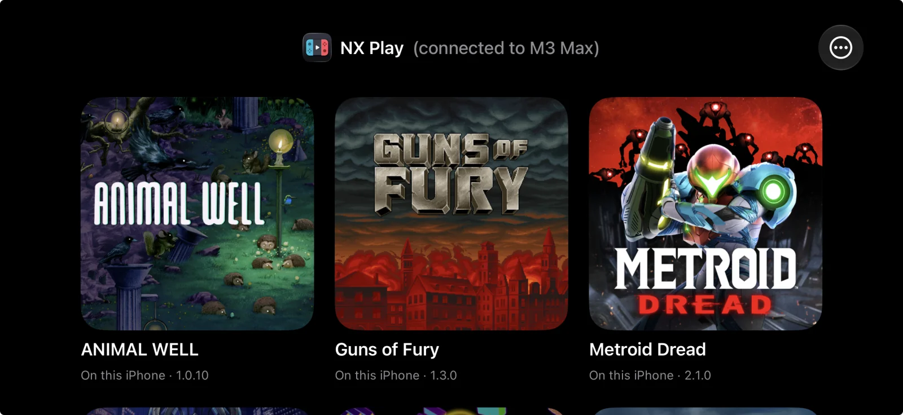
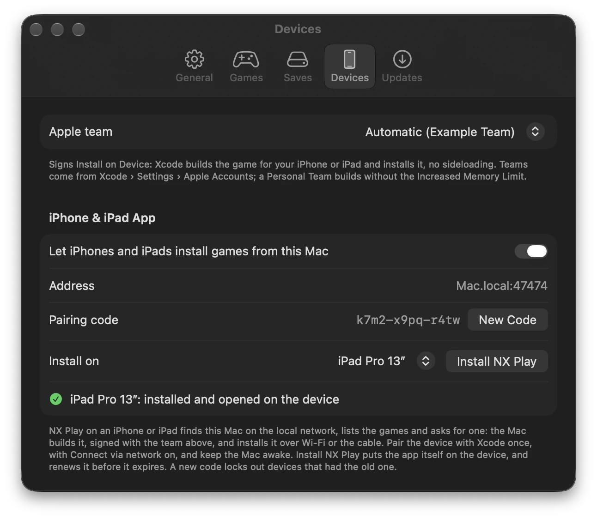
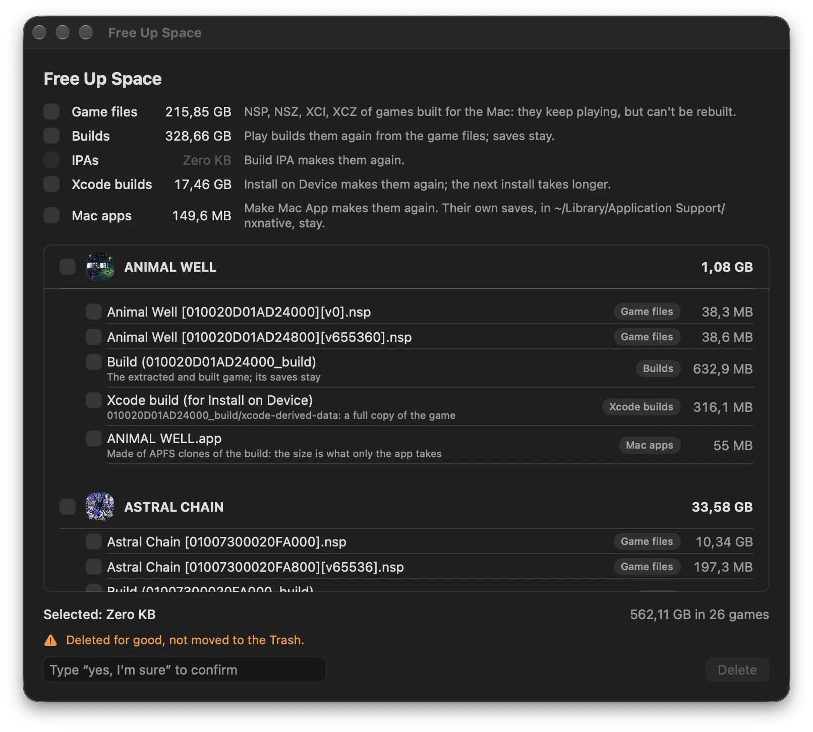
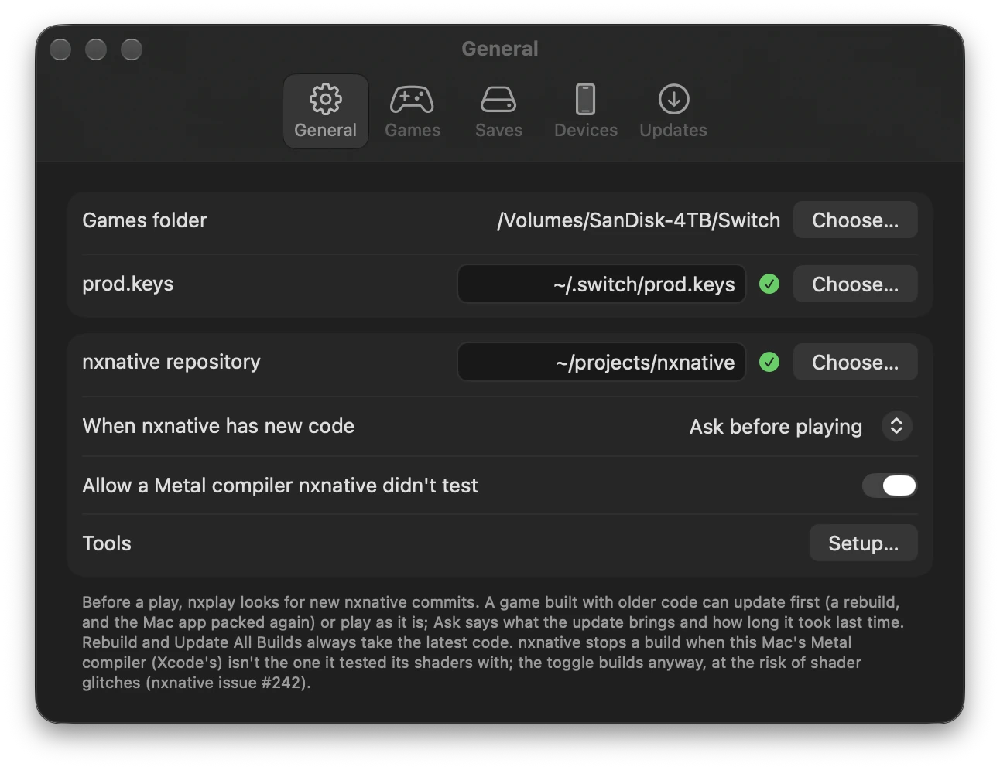
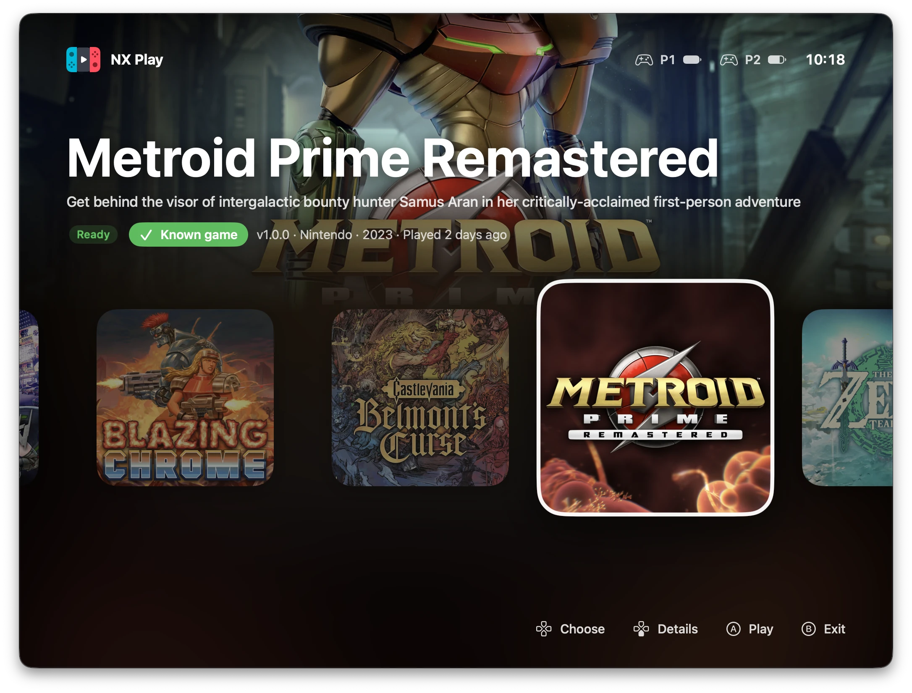
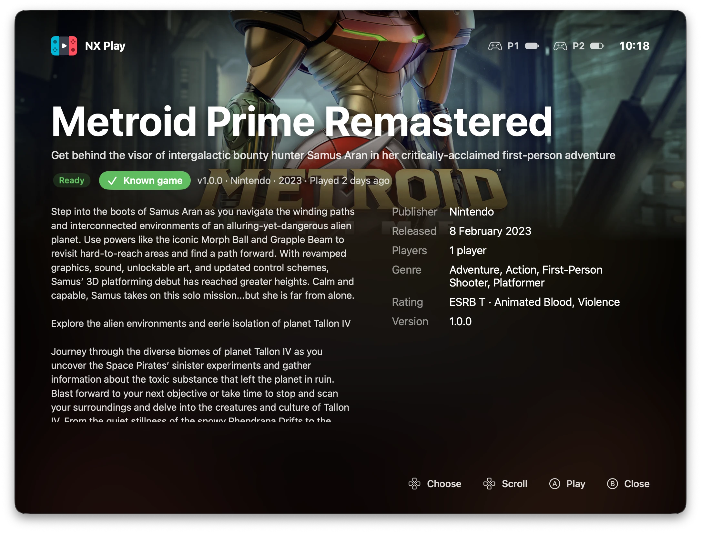

# NX Play

**NX Play** is a Mac app (and `nxplay`, the script behind it) that runs Nintendo Switch games natively on a Mac or an iPhone/iPad, through [nxnative](https://github.com/seedds/nxnative). It builds a game once, then starts it straight away the next time. This repository is `nx-native-wrapper`.

- A library of your games with their icons: extract them, play them on the Mac, rebuild them.
- Console Mode for the couch: full screen, driven by a game controller.
- Install a game on your iPhone or iPad through Xcode, or build an IPA to sideload.
- Copy saves between the Mac and a device, after seeing which one is newer, and back them up to your own private Git repository while you play.
- Pull nxnative's latest fixes before a play and rebuild when they change something, after asking whether to update now or play the current build. Or keep a build that works as it is.

> You need your own games (NSP, NSZ, XCI or XCZ files, or a NUP file or dump of a Switch 2 game) and the `prod.keys` of your own Switch. Nothing here downloads games or keys.

**Contents**

- [Why](#why)
- [Requirements](#requirements)
- [Install](#install), or [from the source](#from-the-source)
- [Using NX Play](#using-nx-play): [the Game menu](#the-game-menu), [iPhone and iPad](#iphone-and-ipad), [saves](#saves), [tools](#tools), [settings](#settings), [Console Mode](#console-mode)
- [Command line](#command-line)
- [Controls](#controls)
- [Troubleshooting](#troubleshooting)
- [Development](#development)
- [License](#license)

## Why

nxnative can pack a game into a standalone Mac app (`--platform mac-app`), with its own settings window. That's an app for one game.

NX Play takes the other route: one app for all your games, everything portable and in one place.

- Each game stays in its own folder: the original files, the build, the saves and the IPA side by side. Move the folder, or the whole library, and it keeps working.
- Playing on the Mac, installing on an iPhone or iPad, moving saves and freeing space all happen from the same window.
- Every game follows nxnative as it improves, with no per-game apps to rebuild and replace.



## Requirements

- A Mac with Apple silicon and macOS 15 or later. On an Intel Mac, IPAs and device installs work, but games cannot run on the Mac.
- [Xcode](https://apps.apple.com/app/xcode/id497799835), opened once. Setup downloads its Metal Toolchain. For iPhone and iPad, its iOS platform too.
- [Homebrew](https://brew.sh): Setup installs the other tools with it.
- For Install on Device: an Apple developer account, signed in under Xcode › Settings › Apple Accounts.

## Install

1. Download the DMG from the [latest release](https://github.com/varyform/nx-native-wrapper/releases/latest) and drag NX Play into Applications.
2. Install [Homebrew](https://brew.sh) if you don't have it: one command in Terminal.
3. Open NX Play. **Setup** opens by itself (later: NX Play › Setup…). It checks the Mac and Xcode and says what to fix. **Install Missing** then:
   - downloads Xcode's Metal Toolchain, which every build needs to compile the game's shaders;
   - installs the tools with Homebrew (uv, xcodegen, zstd, glslang);
   - installs Python and nxnative's packages with [uv](https://docs.astral.sh/uv/), leaving any other Python alone;
   - clones nxnative.

Everything except Homebrew's tools goes into one folder, `~/Library/Application Support/NX Play` (Setup's **Open Folder**).

**NX Play › Uninstall NX Play…** removes it again: its folder, settings, caches and window state, its Dock icon if you kept it there, and the app, which goes to the Trash. It can also remove the Homebrew tools Setup installed. It leaves your games folder (the games, their builds and their saves), `prod.keys`, the save backup repository and Homebrew itself.

NX Play updates itself. It checks GitHub for a new release at launch and once a day (or now, with NX Play › Check for Updates…), and downloads it, verifying its checksum, signature and notarization. The update installs when you quit, or now with **Restart to Update**. With **Settings › Updates › Install updates automatically when idle**, it installs by itself once no game or build runs and NX Play is in the background or hasn't been used for 10 minutes, then opens again: a Mac that builds for another keeps up to date without anyone at it. **What's New** beside it lists what changed since your version; Help › NX Play Changelog has every release. NX Play never interrupts a game or a build to ask. A banner above the library, or a pill in Console Mode's top bar, says an update is ready. In Console Mode, Y (or U) shows what's new. If NX Play can't update itself because it runs from the DMG or from Downloads, the library asks you to move it into Applications.

Put your keys in `~/.switch/prod.keys`, or choose the file in Settings.

### From the source

```sh
git clone https://github.com/varyform/nx-native-wrapper.git
cd nx-native-wrapper
bin/setup
```

`bin/setup` is the same script Setup runs, for a checkout: it also installs the tools in `mise.toml` if you use [mise](https://mise.jdx.dev), puts the Python packages into `.venv` and nxnative into `./nxnative` in the checkout, and builds NX Play into `/Applications`. A build from the checkout keeps using those. `bin/setup --check` reports what is missing without changing anything; `bin/setup --no-app` skips building the app.

## Using NX Play

Open NX Play and add your games folder, with one subfolder per game:

```
Switch/
├── Metroid Dread/
│   └── Metroid Dread [010093801237C000][v0].nsp
├── Super Mario Bros Wonder/
│   └── ….nsz
└── Donkey Kong Bananza/
    ├── base/
    │   ├── exefs/        main, main.npdm, sdk, …
    │   └── romfs/
    └── updates/
        └── 458752/       exefs/ and romfs/ of the update
```

Games spread over several places? **Settings › General › Games Folders** takes more folders, and their games show as one library. A folder there can also be a single game's own folder, with its files at the top level. Builds and saves stay in each game's folder, so nothing rebuilds when you add a folder whose games were built already. A folder on a disk that isn't connected stays in the list, marked "Not connected", and its games come back once the disk is mounted. One folder can't be inside another, so a game never shows twice.

A Switch 2 game is one `.nup` file or a dump of its files, the way [nxnative builds one](https://github.com/seedds/nxnative#switch-2-games). A dump is `base/`, then optionally `updates/<version>/` and `dlc/<title ID>/`; `exefs/` and `romfs/` directly in the folder count as `base/`, and an update's folder can be the whole game. Neither needs `prod.keys`. A game shows its folder's name until it's built, and a dump stays that way, since it carries no icon or name; a NUP that holds them shows them once built. If NSPs sit beside a NUP or a dump, nxnative builds the NSPs, and those need `prod.keys`. A red **Switch 2** after a card's title ID (a badge in the list) marks these games. nxnative tests Switch 2 games on the Mac only. For a game it has no profile for, it guesses one from the game's files, and a **Guessed** badge says so: the game may not boot.

Extracted games show their icons and a **Play** button; the others have **Extract**, and **Extract All** builds them one after another. A status bar at the bottom shows what's building. The log, which starts hidden (View › Show Log, ⇧⌘Y), shows the selected game's output, and opens by itself when a build fails. The toolbar switches between the grid and a sortable list (View › as Grid ⌘1 / as List ⌘2). Its sort and filter menu (also View › Sort By and View › Show) orders both by name, last played or date added. It can also show only Switch or Switch 2 games, the games that need attention (a launcher still to save, an outdated Mac app or nxnative news for the profile), or kept builds. The order is remembered; the filter goes back to all games at the next launch. The list's column headers sort it too.



### The Game menu

Right-click a game for more, or use the **Game** menu:

- **Rebuild**: builds the game again with the current nxnative.
- **Keep This Build**: for a game that plays well. nxnative updates no longer rebuild it, and a lock badge marks it. While it's kept, Install on Device, Build IPA and Make Mac App are off, since they'd rewrite files the kept build runs. Rebuild still replaces it.
- **Game Settings…** (⌥⌘,): the settings nxnative offers for the game, with the defaults it was tested with. Depending on the game these include frame rate, render scale, docked or handheld, upscaling, language, window or full screen, rumble and performance switches. The basic ones come first; the rest are under Advanced settings. Each one follows Settings › Games until you change it for the game. A changed value is tinted and has its own reset button, and **Use Global Settings** resets them all. They apply the next time the game starts, and the log lists them. The game's Mac app shares the game's own values: NX Play keeps them where nxnative's own settings window does. A game nxnative has no profile for gets NX Play's **Frame rate (untested)** instead: **60 fps**, or **120 fps** on a Mac with a 120 Hz screen, a frame each display refresh whatever rate the game asks for. That plays at the right speed in a game that keeps time by the clock, and too fast in one that counts frames, so time a race or a walk before you keep it. A game nxnative has a profile for runs at the rate it was tested at, often 60 already, so it doesn't get this setting. It's the game's own rate by default, each game's own, and the game's Mac app doesn't have it.
- **Install on Device**: builds the game with Xcode, signed with your team, then installs and starts it on a connected iPhone or iPad. The device must be paired with Xcode and in Developer Mode.
- **Build IPA**: an unsigned IPA in the game folder, for AltStore, Sideloadly and the like.
- **Make Mac App**: a standalone, double-clickable app of the game (nxnative's `--platform mac-app`) in the game folder, for the Dock or Launchpad. It's made of APFS clones of the extracted files, so it takes almost no space on the same volume. Once a game has its app, **Play** starts the app, so the Dock shows the game's own name and icon, with the game's save and cheats from its folder and NX Play's settings. When an nxnative update rebuilds the game, the app is packed again with it, which adds a couple of minutes to the rebuild, so Play keeps starting the app. When that can't happen (the game files were removed, or the packing failed), Play uses the build: an orange **App** badge and Console Mode's "App out of date" say so, and **Update Mac App** in the Game menu packs it again. Opened from Finder or the Dock, the app plays on from the same save too: NX Play points it there through the app's `env.txt` in `~/Library/Application Support/nxnative/<title ID>`. The exception is an app that already has a save of its own from before. That one keeps it, and while the two saves differ, **Play** asks which one to use: NX Play's, the app's, or the newer one. **Don't ask again** keeps the answer for the game; **Ask Again** in Game Settings undoes it. The log names the save each play uses.
- **Transfer Saves**: compares the Mac's save with a device's, file by file, and copies one over the other. The replaced save is kept in `<title ID>_build/run/save-backups`.
- **nxnative Notes…** (⌥⌘I): what nxnative says about the game: tested, in bring-up, or no profile (a badge on the artwork says the same), and the profile's commits since your build (a blue badge counts them).
- **Show in Finder**, **Open Save Folder**, **Open Cheats Folder**, **Open Mods Folder**, **Open Build Logs**.
- **Remove Game…** (⌘⌫): deletes the game's files, build, IPAs and Mac app for good. Anything else in its folder stays. Its saves and cheats stay too, in the folder, unless you also remove the saves; put the game files back and it plays on from them. You confirm by typing the phrase it shows.



### iPhone and iPad

**NX Play for iPhone and iPad** is a launcher for your phone or tablet, in `iOS/`. It lists the Mac's games, asks the Mac to install one, and plays the ones already installed. iOS doesn't let one app install another, so the Mac builds the game signed with your team and installs it over Wi-Fi, the way Install on Device does. Built with Xcode 27.2, it fills an iPhone Duo's screen and keeps the tiles on either side of the fold.



To set it up:

1. Pair the device with Xcode once (Window › Devices and Simulators) with **Connect via network** on, and turn on Developer Mode.
2. On the Mac, turn on Settings › Devices › iPhone & iPad App. NX Play then shows up on the local network over Bonjour (`_nxplay._tcp`, port 47474 unless you choose another under **Port**) with a pairing code. **New Code** locks out devices that had the old one.
3. Choose the device and click **Install NX Play** in the same section. NX Play builds the app from the source it carries and signs it with your team. From a checkout, `bin/install-ios <UDID>` does the same; `xcrun devicectl list devices` lists the UDIDs.
4. On the device, tap **Scan QR Code** and scan the code from the Mac's **Show QR Code…**, then pick which of the Mac's devices this one is. Or pick the Mac from the ones found on the network, or type one of its addresses, and enter the code.

Connecting:

- **QR code**: holds the Mac's ID, its name, the pairing code and the addresses it's reached at (local network first, then Tailscale), as `nxplay://pair?v=1&…`. The camera app opens it in NX Play too, and **Copy Link** on the Mac pastes on the device through Universal Clipboard. The device asks before it pairs, and sends the code only to an address that says it's NX Play on that Mac (`GET /v1/hello`, the one request without the code). The QR window is kept out of screenshots and screen sharing and closes after three minutes. The code is kept in the device's Keychain.
- **Bonjour**: finds the Mac on the same local network only. When macOS is slow to confirm it (it can wait for its local network privacy rules after the app was replaced), Settings says so and NX Play registers again until it's visible. The device shows when Local Network access is off for NX Play.
- **Addresses**: Settings › Devices lists the Mac's real addresses (IPv4, IPv6, its `.local` name, Tailscale's). On the device, type `192.168.1.20`, `mac.local:47480`, `[fd7a:115c:a1e0::1]:47474` or a Tailscale name.
- **Tailscale**: Bonjour doesn't cross a tailnet. With Tailscale on both, the QR code's Tailscale addresses (MagicDNS `mac.tailnet.ts.net`, `100.x`, `fd7a:…`) work from anywhere on your tailnet. NX Play only reads `tailscale status`; it changes no Tailscale setting and exposes nothing publicly (no Funnel, no Serve). The device keeps every address that was in the code, and when the Mac stops answering at one, it tries the others, checking each is the same Mac first.
- **Where the code goes**: the device sends its saved code only to the addresses you confirmed when pairing (the QR code's, the one you typed, or those of the Mac you picked). When Bonjour finds your Mac's ID at another address, the library says so and offers **Pair Again with QR Code…**; it doesn't send the saved code there, because anything on the network can claim the Mac's ID (it's public: Bonjour and `/v1/hello` give it to anyone). Requests go straight to the Mac, never through a proxy, and redirects aren't followed. Cancel and Unpair stop a pairing under way.
- **What this relies on**: NX Play talks plain HTTP and the Mac has no key the device checks, so the network matters. On Wi-Fi the code travels unencrypted, as a typed code always did: someone who can read that network's traffic, or take over one of the confirmed addresses there, can learn it. Pair on a network you trust, and use **New Code** if you doubt it. Over Tailscale the traffic is encrypted by WireGuard and the `100.x` addresses belong to your tailnet's devices, but only while Tailscale is connected on the device: without it, a `100.x` address belongs to whatever network the device is on.



The header shows which Mac the device is connected to. Games installed from now on open from the launcher: nxplay gives each one the URL scheme `nxplay-<title ID>`. A game installed before that needs **Reinstall from the Mac** once. The launcher asks the Mac what's on the device whenever it comes to the front, or when you pull down to refresh. A game deleted from the home screen then shows as **Removed from this iPhone** (or iPad), with a one-tap reinstall, because the Mac remembers which games each device has had. A connected controller works too:
- the d-pad or left stick moves through the games
- **A** opens a game, then plays it (or installs it when it isn't on the device)
- **Y** installs it again
- **B** goes back

Games installed with a Personal Team stop opening after 7 days, and with a paid team after a year. The launcher shows how long each game has left. Within two days of expiry, a banner offers **Renew**, which installs those games again. NX Play itself expires the same way: install it again from Settings. Installs go over the cable when the device is plugged in, otherwise over Wi-Fi. The Mac has to be awake and NX Play open. The API is in `Library+Remote.swift`:

```sh
curl http://<mac>.local:47474/v1/hello   # no code: {"app": "nxplay", "api": 1, "id": "<Mac ID>"}
curl -H "Authorization: Bearer <code>" http://<mac>.local:47474/v1/games
curl -X POST -H "Authorization: Bearer <code>" "http://<mac>.local:47474/v1/games/<folder>/install?device=<udid>"
```

### Building on another Mac

One Mac can build another's games, a desktop for a laptop for example, over the local network:

1. On the Mac that builds, turn on **Settings › Remote › Allow remote builds**. It shows a pairing code, and NX Play shows up on the network over Bonjour (`_nxplay-mac._tcp`, port 47475).
2. On the other Mac, click **Pair with Another Mac…** in the same tab, pick the Mac and enter its code. Each code works once, and **Remove** under This Mac unpairs a Mac.
3. Tabs in the middle of the toolbar, **This Mac** and one for each paired Mac with a dot for its connection, switch the main window to that Mac's games. The **+** menu pairs another Mac or unpairs one. Each of its games has **Build**, **Rebuild** or **Stop**, also in its right-click menu, and the selected one's build log shows below. A paired Mac can only build there: it can't play, change settings or reach the files.

Games in a games folder both Macs have, such as one on a file server, are the same games on both: each games folder gets a hidden `.nxplay-folder-id` file, so a game is recognised under any path. While the other Mac builds one of them, its card here shows that build's progress and log, **Cancel** stops it there, and it doesn't build or play here until that's done, since two builds into one folder would spoil each other. The two Macs talk over TLS with a key from the pairing, which nobody who sees the code later can work out.

A folder shared from a Mac with File Sharing works. If it's on an external drive, turn off **Ignore ownership on this volume** in its Get Info first, or the other Mac is told the share doesn't exist. Before building over the network, nxplay switches a game's shader cache out of SQLite's WAL mode, which a network volume can't open: a game built from the drive on the sharing Mac has its cache in that mode. A NAS that strips the execute permission from files, such as a UniFi one, builds a game once, but a rebuild can fail with `Permission denied` when the build runs one of its own tools there a second time.

### Saves

**Save backup** (Settings › Saves): pick a clone of your own private Git repository. While a game plays, NX Play copies its save into a folder named after the game and its title ID (`the-legend-of-zelda-tears-of-the-kingdom-0100f2c0115b6000`) each time the game saves, then commits and pushes. It does this once more when the game quits. Pushing uses your own Git setup (SSH agent or keychain) and never prompts. The log shows each backup. Games started from the Terminal with `nxplay` aren't backed up.

**Cloud saves** (Settings › Saves): a game's Mac and iPhone copies play on from one save, through iCloud Drive (its nxnative Saves folder) or a folder you pick. This is nxnative's own sync: each game keeps one file there, `<title ID>/save.dmsync`. The game brings in the cloud's save when it starts and sends its own a few seconds after each save. On the iPhone, pick the same folder in the game app's Cloud saves. When both sides changed since they were last the same (you played on both without a sync in between, or this Mac had a save of its own before its first sync), **Play** asks which save to use, this Mac's or the cloud's, with when each was saved and on which device. The other is kept in the save's backups. A game built with an nxnative from before 2026-11-08 doesn't ask: the newer save wins. A save made in the last seconds before you quit goes up at the game's next start. From the Terminal: `DM_SAVE_SYNC=icloud nxplay <game folder>`.

### Cheats

nxnative runs Atmosphère-format cheat codes. In a game's window, the **Cheats** menu and its panel (⇧⌘C) turn them on and off while you play, and **Find Cheats…** imports them from Ryujinx, a yuzu-family emulator or a Switch SD card. You can also drop a file onto the panel. **Game › Open Cheats Folder** opens `<title ID>_build/cheats`, where they're kept with your choices of which are on. A downloaded file goes there named `<build ID>.txt`, for the exact build of your game (the panel shows it), and loads the next time the game starts. Free Up Space keeps them, like the saves, and so does Remove Game unless you also remove the saves.

### Mods

Mods that replace or add game files (textures, models, text, sounds) load without a rebuild: nxnative layers them over the game's files (its `DM_ROMFS_OVERLAY`). **Game › Open Mods Folder** opens the game's `Mods` folder. Put each mod in a folder of its own there, holding the `romfs` folder it comes with. A mod shared for a Switch SD card, with `atmosphere/contents/<title ID>/romfs` inside, works as it is. Game Settings lists the mods: turn each one on or off, and drag them into order. When two mods change the same file, the higher one wins, and the lower one's row says how many of its files come from the one above. A new mod is on, and while Game Settings is open, a mod added, removed or changed in Finder shows there at once. NX Play keeps the order in `Mods/order.txt`. Mods load the next time the game starts, and the log lists them. They load in the game's Mac app too, through Play or from Finder, but not in an iPhone app or a device install.

A mod that changes the game's code (`exefs`, or `exefs_patches` such as a 60 fps patch) can't work: nxnative rewrites the game's code when it builds it. Its row says so, and its `romfs` still loads. A mod with new shaders may not draw them, since nxnative translates the game's shaders when it builds it too. A mod made for another version or release of the game may not fit yours.

### Testing an nxnative branch

A `nxnative` link in a game's folder pins the game to that checkout, either a fork or a branch as a worktree of the same clone, so one game can try new code while the rest follow upstream:

```sh
ln -s ~/src/nxnative-fork "<game folder>/nxnative"
```

Everything the game runs uses it (extract, play, rebuild, IPA, Mac app, device install, its settings list), and so do its badges and nxnative Notes. The pre-play update pulls that checkout, so a branch with no upstream stays frozen. The job's log says which checkout a game used, or that it ignored a link that isn't a checkout. A purple branch badge marks such a game in the library, with the checkout and its branch in its tooltip (Console Mode names the branch), and an orange one marks a link that isn't a checkout. Remove the link to go back to the shared one.

### Tools

**Tools › Update All Builds…** builds every game with the current nxnative, one after another, so none of them makes you wait when you want to play. A build after an nxnative update can take from a few minutes to an hour, mostly the game's shaders. After an Xcode update every game recompiles them once. A game that's already current takes seconds. Kept builds and games without their game files are skipped. With **Only while plugged in**, the next build waits while the Mac is on battery. While a build runs, NX Play keeps the Mac awake (the display can sleep), so it can run overnight.

**Tools › Free Up Space** lists, per game and with their sizes, what you can delete:

- **Game files:** each game's NSP, NSZ, XCI, XCZ and NUP files, plus the NSPs a build converted from NSZ. Only games already built for the Mac qualify, since they keep playing from their build. Without these files a game can't be rebuilt: it keeps its current build when nxnative updates, and Install on Device and Build IPA need the files back. If your games folder holds your only copy, keep a backup.
- **Builds:** each game's `<title ID>_build` folder: the extracted game, its rewritten code and its shaders. The next Play builds it again from the game files, which takes as long as the first build. Its saves and cheats stay, and so does when you last played it. A game whose game files are gone keeps its build, since that's how it still plays; a kept build stays too. A game's build and its game files can't be deleted together.
- **Shader compile caches:** `<title ID>_build/shader/cache/cas.db`, where a build keeps its compiled shaders. Each nxnative update that changes how shaders are built adds another set, and nxnative doesn't remove the old ones yet, so it can grow to tens of GB. The game plays without it, from the shader library beside it. The cost is the next rebuild, which compiles every shader again. That can take hours for a big game, though after an nxnative update most shaders compile again anyway. A game that hasn't finished its first build keeps its cache, since the build goes on from it. A build's size leaves its cache out, and removing the build takes the cache too.
- **IPAs:** the ones built for sideloading. Build IPA makes them again.
- **Xcode builds:** `<title ID>_build/xcode-derived-data`, which Install on Device keeps to make the next install fast. It's a full copy of the game. Without it the next install works, but compiles and copies everything again.
- **Device install copies:** for each device, Xcode's device service keeps a copy of the app it last installed, so the next install sends only what changed. A game's app holds the whole game, so each copy is as big as the game, and it's on the Mac's own disk wherever your games folder is. Without them the next install copies the whole game again. After each Install on Device, NX Play also removes the game's copies from older builds, which the service keeps too. The copies are in `~/Library/Containers/com.apple.CoreDevice.CoreDeviceService`, which macOS opens only to apps with Full Disk Access. Without it, Free Up Space offers **Give Access…**: System Settings opens at Full Disk Access, with a small window beside it holding NX Play's icon to drag into the list. That window says when the access is on. If an earlier NX Play is already in the list, remove it first: its entry looks switched on but doesn't count for this one.
- **Mac apps:** the ones Make Mac App packed into the game folder, with nxnative's `.app.key` beside each. An app is made of APFS clones of its build's files, so Finder may show it at several GB while deleting it frees only what the app alone takes, usually tens of MB. That's the size listed. Make Mac App makes it again, and the app's own save in `~/Library/Application Support/nxnative` stays.
- **Metal's leftovers:** not one game's. When a game plays, nxnative captures its pipelines through Metal, and Metal keeps compiler state for each capture in a `gpuarchiver-*` folder of about 45 MB in the user cache folder (`com.apple.gpuarchiver`). It never removes them, and nothing reads them again, so weeks of play can leave tens of gigabytes. Only folders untouched for a day are listed, since other apps' Metal state lives there too, and none can go while a game runs.

Pick files one by one, a whole game, or a whole kind. Nothing is selected until you pick it, and deleting needs you to type “yes, I'm sure”. Everything is deleted for good, not moved to the Trash.



nxnative unpacks an NSZ or XCZ into the build folder's `nsp/` before building, and keeps that copy, so the game takes up its space about twice, and a build without the folder unpacks it again. **Settings › General › Keep only the unpacked copy of NSZ and XCZ games** stops that. Once a game is built for the Mac, its unpacked NSP or XCI moves into the game folder and the NSZ or XCZ goes to the Trash; from then on the game builds from the NSP. Only a file nxnative recorded as unpacked from exactly that NSZ moves, and nothing moves while the game builds or runs. Turning it on offers to do the same for the games built already. It's off by default, since it changes your own files.

### Settings

Settings has a tab for each subject: **General** (the games folders, the keys file, keeping only the unpacked copy of compressed games, the nxnative folder, the Metal compiler check, Setup), **Games** (the settings every game gets unless it has its own, and the controllers), **Saves** (the backup repository, cloud saves), **Devices** (the Apple team for device installs, and the [iPhone & iPad app](#iphone-and-ipad)), **Remote** ([building on another Mac](#building-on-another-mac)) and **Updates**. **Game Controls** (in the menu bar, and the keyboard button in the toolbar) shows the keyboard controls. While builds run, the Dock icon shows their progress.



### Console Mode

**On the couch:** a game controller drives the library. The D-pad or left stick chooses a game, A plays it, and Menu switches to **Console Mode** (also ⇧⌘F): full screen. A, B and Y are the Switch's, as the games read them: on an Xbox or PlayStation controller A is the right button and B the bottom one, and the hints show the button to press. The selected game's eShop banner fills the top half, with its name and badges. Below it, the games ready to play sit in a row of their artwork, the one you played last first, with the clock and the controller's button hints. Games started from it open full screen; Settings › Games can make every game start that way. B or Esc goes back. Any connected controller drives it. In a game each controller is a player of its own, in the order they connected (player 1 shares with the keyboard), up to 8; the top bar shows each one's player number. Settings › Games › Controllers can make the keyboard player 1 on its own, or every controller player 1.



Down (or a click on the game's name) opens the game's details: the banner and the name slide up, and the eShop's description, facts (publisher, release date, players, genre, age rating) and screenshots take the row's place. Down scrolls the description, then moves to the screenshots, where left and right choose one and A shows it full screen. Left and right on the description move to the next game. Up at the top, B or Esc close the details. A trackpad or mouse scrolls and clicks too. The artwork and details come from [blawar/titledb](https://github.com/blawar/titledb), the community list NX2Apple uses too. A game it doesn't have, such as every Switch 2 game and the newest Switch ones, gets them from its page on Nintendo's US store. The images come only from Nintendo's servers. A game whose files have no icon of its own (one packed from a `.nup` may not) shows the eShop's icon, and its Mac app or iPhone app gets that icon too.



## Command line

`nxplay` does what the app does, from a terminal:

```sh
./nxplay ~/Games/MetroidDread              # start the game, or build it first if needed
./nxplay --rebuild ~/Games/MetroidDread    # force a rebuild
./nxplay --build-only ~/Games/MetroidDread # build if needed, don't start
./nxplay --ipa ~/Games/MetroidDread        # build the iOS IPA into the game folder, to sideload
./nxplay --mac-app ~/Games/MetroidDread    # pack a standalone Mac app of the game into its folder
./nxplay --device <udid> ~/Games/MetroidDread --team-id <team>   # build with Xcode, install and start on a device
./nxplay --fps ~/Games/MetroidDread        # show the Metal performance HUD
./nxplay --fullscreen ~/Games/MetroidDread # start the game in full screen
./nxplay --lang ja ~/Games/MetroidDread    # play in another language (DM_LANG), no rebuild
./nxplay --settings ~/Games/MetroidDread   # write the game's settings list (<title ID>_build/nxplay-settings.json)
DM_FPS_TARGET=30 ./nxplay ~/Games/MetroidDread   # any of the game's settings, for one start
./nxplay --allow-other-metal ~/Games/MetroidDread   # build with a Metal compiler nxnative didn't test
./nxplay ~/Games/MetroidDread -l ja        # extra options go to build_ipa_from_nsp.py
```

`xcrun devicectl list devices` lists the device UDIDs.

Each run starts by updating nxnative and lists any new commits. A game is rebuilt when its Mac build was made with other nxnative code than the checkout has now, whichever run pulled the update. A kept build is the exception: NX Play's Keep This Build puts a `keep` file in `<title ID>_build`, and that build then plays as it is until an explicit `--rebuild`, while `--ipa`, `--mac-app` and `--device` refuse to run for it. Before a play, `NXPLAY_UPDATE` decides what happens to a game built with older code: `update` (the default) pulls and rebuilds, `current` plays the build as it is and leaves the checkout alone, and `ask` first shows what the update brings (the commit count, the game's own commits, whether every shader is translated again, how long the last update took) and asks. NX Play asks by default; Settings › General changes it. The `./nxnative` clone is only for following upstream: when upstream rewrites its history, nxplay follows it, so keep your own nxnative changes in another clone (`NXNATIVE=/path/to/it`).

The run command is saved in `<game folder>/<title ID>_build/start_mac.sh`. It holds absolute paths, so after you move a game folder (or nxnative), the next run rewrites them to the new location.

Environment variables: `NXNATIVE` (the nxnative checkout; default `./nxnative`, else `../nxnative`), `NX_KEYS` (default `~/.switch/prod.keys`), `NXPLAY_VENV` (default `./.venv`).

## Controls

| Key | Switch button |
| --- | --- |
| W A S D | Left stick |
| Arrow keys | D-pad |
| J / K / U / I | A / B / X / Y |
| Q / E | L / R |
| Z / C | ZL / ZR |
| F / G | Press left stick / press right stick |
| Return / Tab | + / − |
| Space | Shake the controller (while held) |
| Left mouse button | Touchscreen |
| ⌃⌘F | Toggle full screen |
| ⌘Q | Quit the game |

Controllers are detected automatically, with buttons by position (right A, bottom B, top X, left Y). Extra controllers become extra players for local co-op, in the order they connected. **Settings › Games › Controllers** can make the keyboard a player of its own or every controller player 1. Once a game built with a recent nxnative offers it, **Press a button to join** lets players choose their numbers instead: a controller becomes a player at its first button press, taking the lowest player free. Press on every controller before the game asks how many play.

## Troubleshooting

### Where to report a problem

NX Play builds and runs games with [nxnative](https://github.com/seedds/nxnative). It doesn't touch the games themselves, so most game problems belong there:

- **Report to [nxnative's issues](https://github.com/seedds/nxnative/issues):** a game that crashes, freezes, shows a black screen or glitches. Also a game that doesn't boot on the Mac or on an iPhone or iPad, and a build or IPA that fails in one of nxnative's steps (extract, rewrite, shader split, shaders, Mac host, Xcode project). Search first: the game may be known, or not supported yet. Include the game's title ID and version, your Mac or device, and the step's log from **Open Build Logs**.
- **Report [here](https://github.com/varyform/nx-native-wrapper/issues):** NX Play's own windows and buttons, Setup, updates, Install on Device, Transfer Saves, Save backup, Console Mode and the controller, Free Up Space, and `nxplay` itself.

Not sure? Run nxnative's build script on the game yourself (`python3 scripts/build_ipa_from_nsp.py <game folder> -k ~/.switch/prod.keys` in the nxnative folder; `--platform mac` for the Mac). If it fails the same way, it's nxnative's.

### Common problems

- **Start with `bin/setup --check`.** It finds most problems.
- **A game that played well breaks after an nxnative update:** report it to nxnative, Rebuild once a fix lands, and use Keep This Build on games that work to avoid it.
- **A build fails:** the panel shows the error, and **Open Build Logs** has each step's full output. A build that finishes without part of what it makes says **done, with a warning** in orange, with that step's line in the log in orange too. So far that's a Mac app or an IPA whose pipeline archive failed: it's packed without one and builds the pipelines on its first start, which makes that start slower. Games and the build steps themselves are nxnative's: see its [README](https://github.com/seedds/nxnative#readme) and [known issues](https://github.com/seedds/nxnative#known-issues).
- **No device in Install on Device:** connect it once by cable, trust the Mac, and turn on Developer Mode (Settings › Privacy & Security). **Look Again** refreshes the list.
- **"No Apple developer team":** sign in under Xcode › Settings › Apple Accounts. A free Personal Team works, but without the Increased Memory Limit, so bigger games may be closed by iOS.

## Development

```sh
bin/build        # build/Build/Products/Release/NX Play.app
bin/install      # build and install into /Applications (or: bin/install ~/Applications)
mise run app     # build and open it
mise run test    # NXPlayKit tests (swift test --package-path Packages/NXPlayKit)
mise run stats   # lines of code, types and functions per part of the repo, as rails stats (bin/stats)
bin/release 1.7.12 "Stair Climber"  # release (the name is optional): sign, notarize, DMG, then (after you confirm, or at once with -y) commit, tag and publish
```

`bin/release` needs a Developer ID Application certificate and a notarytool profile (`xcrun notarytool store-credentials nxplay-notary`). It moves the changelog's Unreleased notes under the new version and bumps the version in `project.yml`. It builds with the hardened runtime and without the checkout's paths, so the release keeps everything in its own folder. The app and the DMG are notarized and stapled. Nothing is committed, pushed or published until you confirm (`-y` publishes without asking once the DMG is notarized), and the DMG stays in `build/release`. Released apps update from the latest GitHub release's DMG, using the SHA-256 digest GitHub records for each uploaded asset.

A checkout build doesn't update itself. To see the update notices anyway, open it with `open -a "NX Play" --args -NXPlayPreviewUpdate ready` (or `waiting` for the reminder after a few days, or `problem` for the move-into-Applications banner). It fakes an update with the changelog's Unreleased notes. Restart to Update then only quits, and released apps ignore the argument.

When NX Play is running, `bin/install` asks it to quit once no game, build or file work is running, waits for that, replaces it and opens it again.

To work in Xcode, run `xcodegen generate` (or `mise run generate`) and open `NXPlay.xcodeproj`. The code lives in the `Packages/NXPlayKit` Swift package; `project.yml` describes the app.

`Package.swift` in the root exists only so SourceKit-LSP (Zed, VS Code, …) understands the app's sources; build and test with the Xcode project and `Packages/NXPlayKit`.

`bin/screenshots [games folder]` regenerates the screenshots in `docs/`. It needs a folder with at least one extracted game (default `~/Games/Switch`), and it shows the folder's real games, with their names and icons. Everything else is sample data: paths under `~`, an example team, devices and controller, a scripted build log. `bin/screenshots ~/Games/Switch console` redoes just one scene (library, list, console, console-details, free-up-space, settings, devices, transfer-saves). `NXPLAY_SCREENSHOT_GAME="Breath of the Wild"` (a title ID or part of a name) picks the game Console Mode shows. The data lives in `Screenshots.swift`, which only Debug builds include. It needs `cwebp` (`brew install webp`) and Screen Recording permission for your terminal.

## License

MIT, see [LICENSE](LICENSE). nxnative has its own license.
