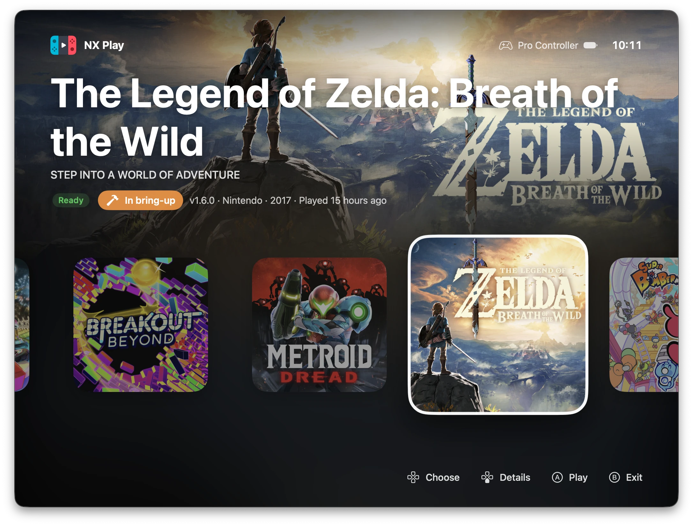
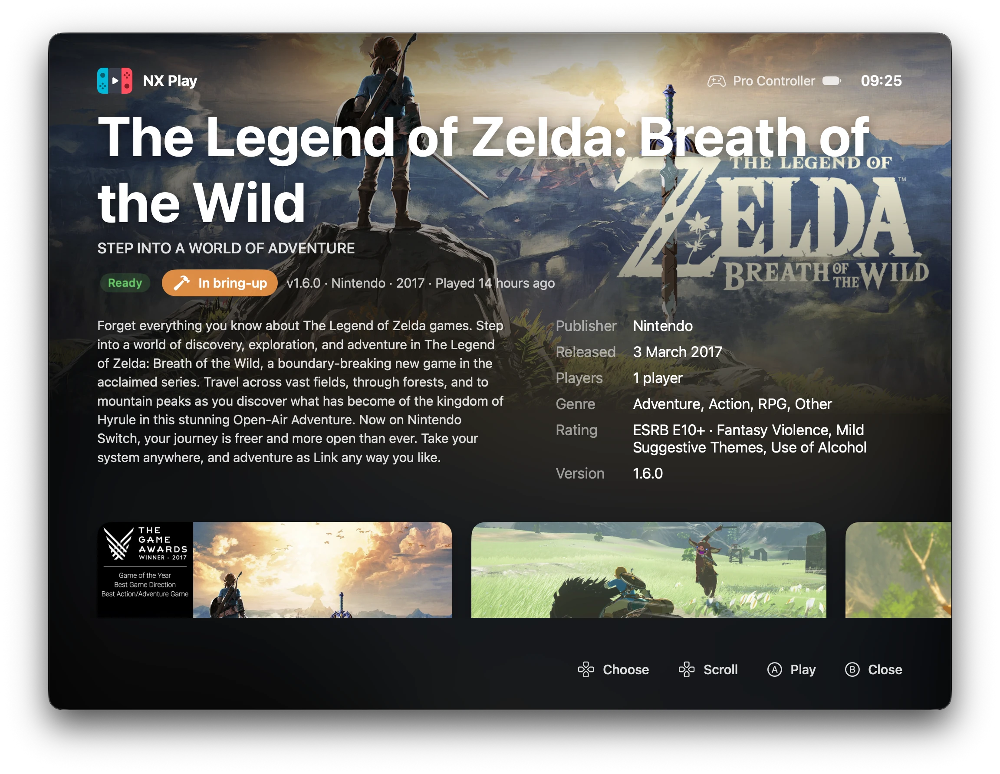

# NX Play

**NX Play** is a Mac app (and `nxplay`, the script behind it) that runs Nintendo Switch games natively on a Mac or an iPhone/iPad, through [nxnative](https://github.com/seedds/nxnative). It builds a game once, then starts it straight away the next time. This repository is `nx-native-wrapper`.

- A library of your games with their icons: extract them, play them on the Mac, rebuild them.
- Console Mode for the couch: full screen, driven by a game controller.
- Install a game on your iPhone or iPad through Xcode, or build an IPA to sideload.
- Copy saves between the Mac and a device, after seeing which one is newer, and back them up to your own private Git repository while you play.
- Pull nxnative's latest fixes before each run and rebuild when they change something, or keep a build that works as it is.

> You need your own games (NSP, NSZ, XCI or XCZ files) and the `prod.keys` of your own Switch. Nothing here downloads games or keys.

## Why

nxnative can pack a game into a standalone Mac app (`--platform mac-app`), with its own settings window. That's an app for one game.

NX Play takes the other route: one app for all your games, everything portable and in one place.

- Each game stays in its own folder: the original files, the build, the saves and the IPA side by side. Move the folder, or the whole library, and it keeps working.
- Playing on the Mac, installing on an iPhone or iPad, moving saves and freeing space all happen from the same window.
- Every game follows nxnative as it improves, with no per-game apps to rebuild and replace.


## Requirements

- A Mac with Apple silicon and macOS 15 or later. On an Intel Mac, IPAs and device installs work, but games cannot run on the Mac.
- [Xcode](https://apps.apple.com/app/xcode/id497799835), opened once. Setup downloads its Metal Toolchain. For iPhone and iPad, its iOS platform too.
- [Homebrew](https://brew.sh): Setup installs the other tools with it.
- For Install on Device: an Apple developer account, signed in under Xcode › Settings › Apple Accounts.

## Install

1. Download the DMG from the [latest release](https://github.com/varyform/nx-native-wrapper/releases/latest) and drag NX Play into Applications.
2. Install [Homebrew](https://brew.sh) if you don't have it: one command in Terminal.
3. Open NX Play. **Setup** opens by itself (later: NX Play › Setup…). It checks the Mac and Xcode and says what to fix. **Install Missing** then:
   - downloads Xcode's Metal Toolchain, which every build needs to compile the game's shaders;
   - installs the tools with Homebrew (uv, xcodegen, zstd, glslang, the .NET SDK), asking for your password for the .NET SDK;
   - installs Python and nxnative's packages with [uv](https://docs.astral.sh/uv/), leaving any other Python alone;
   - clones nxnative.

Everything except Homebrew's tools goes into one folder, `~/Library/Application Support/NX Play` (Setup's **Open Folder**).

**NX Play › Uninstall NX Play…** removes it again: its folder, settings, caches and window state, its Dock icon if you kept it there, and the app, which goes to the Trash. It can also remove the Homebrew tools Setup installed. It leaves your games folder (the games, their builds and their saves), `prod.keys`, the save backup repository and Homebrew itself.

NX Play updates itself. It checks GitHub for a new release at launch and once a day (or now, with NX Play › Check for Updates…), and downloads it, verifying its checksum, signature and notarization. The update installs when you quit, or now with **Restart to Update**. **What's New** beside it lists what changed since your version; Help › NX Play Changelog has every release. NX Play never interrupts a game or a build to ask. A banner above the library, or a pill in Console Mode's top bar, says an update is ready. In Console Mode, Y (or U) shows what's new. If NX Play can't update itself because it runs from the DMG or from Downloads, the library asks you to move it into Applications.

Put your keys in `~/.switch/prod.keys`, or choose the file in Settings.

### From the source

```sh
git clone https://github.com/varyform/nx-native-wrapper.git
cd nx-native-wrapper
bin/setup
```

`bin/setup` is the same script Setup runs, for a checkout: it also installs the tools in `mise.toml` if you use [mise](https://mise.jdx.dev), puts the Python packages into `.venv` and nxnative into `./nxnative` in the checkout, and builds NX Play into `/Applications`. A build from the checkout keeps using those. `bin/setup --check` reports what is missing without changing anything; `bin/setup --no-app` skips building the app.

## Using NX Play

Open NX Play and choose your games folder, with one subfolder per game:

```
Switch/
├── Metroid Dread/
│   └── Metroid Dread [010093801237C000][v0].nsp
└── Super Mario Bros Wonder/
    └── ….nsz
```

Extracted games show their icons and a **Play** button; the others have **Extract**, and **Extract All** builds them one after another. A status bar at the bottom shows what's building. The log, which starts hidden (View › Show Log, ⇧⌘Y), shows the selected game's output, and opens by itself when a build fails. The toolbar switches between the grid and a sortable list (View › as Grid ⌘1 / as List ⌘2).


Right-click a game for more, or use the **Game** menu:

- **Rebuild**: builds the game again with the current nxnative.
- **Keep This Build**: for a game that plays well. nxnative updates no longer rebuild it, and a lock badge marks it. While it's kept, Install on Device, Build IPA and Make Mac App are off, since they'd rewrite files the kept build runs. Rebuild still replaces it.
- **Game Settings…** (⌥⌘,): the settings nxnative offers for the game, with the defaults it was tested with. Depending on the game these include frame rate, render scale, docked or handheld, upscaling, language, window or full screen, rumble and performance switches. The basic ones come first; the rest are under Advanced settings. Each one follows Settings › Games until you change it for the game. A changed value is tinted and has its own reset button, and **Use Global Settings** resets them all. They apply the next time the game starts, and the log lists them. The game's Mac app shares the game's own values: NX Play keeps them where nxnative's own settings window does.
- **Install on Device**: builds the game with Xcode, signed with your team, then installs and starts it on a connected iPhone or iPad. The device must be paired with Xcode and in Developer Mode.
- **Build IPA**: an unsigned IPA in the game folder, for AltStore, Sideloadly and the like.
- **Make Mac App**: a standalone, double-clickable app of the game (nxnative's `--platform mac-app`) in the game folder, for the Dock or Launchpad. It's made of APFS clones of the extracted files, so it takes almost no space on the same volume. It keeps its own save in `~/Library/Application Support/nxnative/<title ID>`, separate from NX Play's.
- **Transfer Saves**: compares the Mac's save with a device's, file by file, and copies one over the other. The replaced save is kept in `<title ID>_build/run/save-backups`.
- **nxnative Notes…** (⌥⌘I): what nxnative says about the game: tested, in bring-up, or no profile (a badge on the artwork says the same), and the profile's commits since your build (a blue badge counts them).
- **Show in Finder**, **Open Save Folder**, **Open Build Logs**.
- **Remove Game…** (⌘⌫): deletes the game's files, build, IPAs and Mac app for good. Anything else in its folder stays. Its saves stay too, in the folder, unless you also remove them; put the game files back and it plays on from them. You confirm by typing the phrase it shows.


**Save backup** (Settings): pick a clone of your own private Git repository. While a game plays, NX Play copies its save into a folder named after the game and its title ID (`the-legend-of-zelda-tears-of-the-kingdom-0100f2c0115b6000`) each time the game saves, then commits and pushes. It does this once more when the game quits. Pushing uses your own Git setup (SSH agent or keychain) and never prompts. The log shows each backup. Games started from the Terminal with `nxplay` aren't backed up.

**Cloud saves** (Settings › Saves): a game's Mac and iPhone copies play on from one save, through iCloud Drive (its nxnative Saves folder) or a folder you pick. This is nxnative's own sync: each game keeps one file there, `<title ID>/save.dmsync`. The game brings in the cloud's save when it starts and sends its own a few seconds after each save. On the iPhone, pick the same folder in the game app's Cloud saves. When both sides changed, the newer save wins and the other is kept in the save's backups. A save made in the last seconds before you quit goes up at the game's next start. From the Terminal: `DM_SAVE_SYNC=icloud nxplay <game folder>`.

**Tools › Update All Builds…** builds every game with the current nxnative, one after another, so none of them makes you wait when you want to play. A build after an nxnative update can take from a few minutes to an hour, mostly the game's shaders. After an Xcode update every game recompiles them once. A game that's already current takes seconds. Kept builds and games without their game files are skipped. With **Only while plugged in**, the next build waits while the Mac is on battery. While a build runs, NX Play keeps the Mac awake (the display can sleep), so it can run overnight.

**Tools › Free Up Space** lists, per game and with their sizes, what you can delete:

- **Game files:** each game's NSP, NSZ, XCI and XCZ files, plus the NSPs a build converted from NSZ. Only games already built for the Mac qualify, since they keep playing from their build. Without these files a game can't be rebuilt: it keeps its current build when nxnative updates, and Install on Device and Build IPA need the files back. If your games folder holds your only copy, keep a backup.
- **Builds:** each game's `<title ID>_build` folder: the extracted game, its rewritten code and its shaders. The next Play builds it again from the game files, which takes as long as the first build. Its saves stay, and so does when you last played it. A game whose game files are gone keeps its build, since that's how it still plays; a kept build stays too. A game's build and its game files can't be deleted together.
- **IPAs:** the ones built for sideloading. Build IPA makes them again.
- **Xcode builds:** `<title ID>_build/xcode-derived-data`, which Install on Device keeps to make the next install fast. It's a full copy of the game. Without it the next install works, but compiles and copies everything again.

Pick files one by one, a whole game, or a whole kind. Nothing is selected until you pick it, and deleting needs you to type “yes, I'm sure”. Everything is deleted for good, not moved to the Trash.


Settings has a tab for each subject: **General** (the games folder, the keys file, the nxnative folder, the Metal compiler check, Setup), **Games** (the settings every game gets unless it has its own, and the controllers), **Saves** (the backup repository, cloud saves), **Devices** (the Apple team for device installs) and **Updates**. **Game Controls** (in the menu bar, and the keyboard button in the toolbar) shows the keyboard controls. While builds run, the Dock icon shows their progress.

**On the couch:** a game controller drives the library. The D-pad or left stick chooses a game, A plays it, and Menu switches to **Console Mode** (also ⇧⌘F): full screen. A, B and Y are the Switch's, as the games read them: on an Xbox or PlayStation controller A is the right button and B the bottom one, and the hints show the button to press. The selected game's eShop banner fills the top half, with its name and badges. Below it, the games ready to play sit in a row of their artwork, the one you played last first, with the clock and the controller's button hints. Games started from it open full screen; Settings › Games can make every game start that way. B or Esc goes back. Any connected controller drives it. In a game each controller is a player of its own, in the order they connected (player 1 shares with the keyboard), up to 8; the top bar shows each one's player number. Settings › Games › Controllers can make the keyboard player 1 on its own, or every controller player 1.



Down (or a click on the game's name) opens the game's details: the banner and the name slide up, and the eShop's description, facts (publisher, release date, players, genre, age rating) and screenshots take the row's place. Down scrolls the description, then moves to the screenshots, where left and right choose one and A shows it full screen. Left and right on the description move to the next game. Up at the top, B or Esc close the details. A trackpad or mouse scrolls and clicks too. The artwork and details come from [blawar/titledb](https://github.com/blawar/titledb), the community list NX2Apple uses too; the images only from Nintendo's image server.




## Command line

`nxplay` does what the app does, from a terminal:

```sh
./nxplay ~/Games/MetroidDread              # start the game, or build it first if needed
./nxplay --rebuild ~/Games/MetroidDread    # force a rebuild
./nxplay --build-only ~/Games/MetroidDread # build if needed, don't start
./nxplay --ipa ~/Games/MetroidDread        # build the iOS IPA into the game folder, to sideload
./nxplay --mac-app ~/Games/MetroidDread    # pack a standalone Mac app of the game into its folder
./nxplay --device <udid> ~/Games/MetroidDread --team-id <team>   # build with Xcode, install and start on a device
./nxplay --fps ~/Games/MetroidDread        # show the Metal performance HUD
./nxplay --fullscreen ~/Games/MetroidDread # start the game in full screen
./nxplay --lang ja ~/Games/MetroidDread    # play in another language (DM_LANG), no rebuild
./nxplay --settings ~/Games/MetroidDread   # write the game's settings list (<title ID>_build/nxplay-settings.json)
DM_FPS_TARGET=30 ./nxplay ~/Games/MetroidDread   # any of the game's settings, for one start
./nxplay --allow-other-metal ~/Games/MetroidDread   # build with a Metal compiler nxnative didn't test
./nxplay ~/Games/MetroidDread -l ja        # extra options go to build_ipa_from_nsp.py
```

`xcrun devicectl list devices` lists the device UDIDs.

Each run starts by updating nxnative and lists any new commits. A game is rebuilt when its Mac build was made with other nxnative code than the checkout has now, whichever run pulled the update. A kept build is the exception: NX Play's Keep This Build puts a `keep` file in `<title ID>_build`, and that build then plays as it is until an explicit `--rebuild`, while `--ipa`, `--mac-app` and `--device` refuse to run for it. The `./nxnative` clone is only for following upstream: when upstream rewrites its history, nxplay follows it, so keep your own nxnative changes in another clone (`NXNATIVE=/path/to/it`).

The run command is saved in `<game folder>/<title ID>_build/start_mac.sh`. It holds absolute paths, so after you move a game folder (or nxnative), the next run rewrites them to the new location.

Environment variables: `NXNATIVE` (the nxnative checkout; default `./nxnative`, else `../nxnative`), `NX_KEYS` (default `~/.switch/prod.keys`), `NXPLAY_VENV` (default `./.venv`).

## Controls

| Key | Switch button |
| --- | --- |
| W A S D | Left stick |
| Arrow keys | D-pad |
| J / K / U / I | A / B / X / Y |
| Q / E | L / R |
| Z / C | ZL / ZR |
| F / G | Press left stick / press right stick |
| Return / Tab | + / − |
| Space | Shake the controller (while held) |
| Left mouse button | Touchscreen |
| ⌃⌘F | Toggle full screen |
| ⌘Q | Quit the game |

Controllers are detected automatically, with buttons by position (right A, bottom B, top X, left Y). Extra controllers become extra players for local co-op.

## Troubleshooting

### Where to report a problem

NX Play builds and runs games with [nxnative](https://github.com/seedds/nxnative). It doesn't touch the games themselves, so most game problems belong there:

- **Report to [nxnative's issues](https://github.com/seedds/nxnative/issues):** a game that crashes, freezes, shows a black screen or glitches. Also a game that doesn't boot on the Mac or on an iPhone or iPad, and a build or IPA that fails in one of nxnative's steps (extract, rewrite, shader split, shaders, Mac host, Xcode project). Search first: the game may be known, or not supported yet. Include the game's title ID and version, your Mac or device, and the step's log from **Open Build Logs**.
- **Report [here](https://github.com/varyform/nx-native-wrapper/issues):** NX Play's own windows and buttons, Setup, updates, Install on Device, Transfer Saves, Save backup, Console Mode and the controller, Free Up Space, and `nxplay` itself.

Not sure? Run nxnative's build script on the game yourself (`python3 scripts/build_ipa_from_nsp.py <game folder> -k ~/.switch/prod.keys` in the nxnative folder; `--platform mac` for the Mac). If it fails the same way, it's nxnative's.

### Common problems

- **Start with `bin/setup --check`.** It finds most problems.
- **A game that played well breaks after an nxnative update:** report it to nxnative, Rebuild once a fix lands, and use Keep This Build on games that work to avoid it.
- **A build fails:** the panel shows the error, and **Open Build Logs** has each step's full output. Games and the build steps themselves are nxnative's: see its [README](https://github.com/seedds/nxnative#readme) and [known issues](https://github.com/seedds/nxnative#known-issues).
- **No device in Install on Device:** connect it once by cable, trust the Mac, and turn on Developer Mode (Settings › Privacy & Security). **Look Again** refreshes the list.
- **"No Apple developer team":** sign in under Xcode › Settings › Apple Accounts. A free Personal Team works, but without the Increased Memory Limit, so bigger games may be closed by iOS.

## Development

```sh
bin/build        # build/Build/Products/Release/NX Play.app
bin/install      # build and install into /Applications (or: bin/install ~/Applications)
mise run app     # build and open it
mise run test    # NXPlayKit tests (swift test --package-path Packages/NXPlayKit)
bin/release 1.7.12 "Stair Climber"  # release (the name is optional): sign, notarize, DMG, then (after you confirm) commit, tag and publish
```

`bin/release` needs a Developer ID Application certificate and a notarytool profile (`xcrun notarytool store-credentials nxplay-notary`). It moves the changelog's Unreleased notes under the new version and bumps the version in `project.yml`. It builds with the hardened runtime and without the checkout's paths, so the release keeps everything in its own folder. The app and the DMG are notarized and stapled. Nothing is committed, pushed or published until you confirm, and the DMG stays in `build/release`. Released apps update from the latest GitHub release's DMG, using the SHA-256 digest GitHub records for each uploaded asset.

A checkout build doesn't update itself. To see the update notices anyway, open it with `open -a "NX Play" --args -NXPlayPreviewUpdate ready` (or `waiting` for the reminder after a few days, or `problem` for the move-into-Applications banner). It fakes an update with the changelog's Unreleased notes. Restart to Update then only quits, and released apps ignore the argument.

When NX Play is running, `bin/install` asks it to quit once no game, build or file work is running, waits for that, replaces it and opens it again.

To work in Xcode, run `xcodegen generate` (or `mise run generate`) and open `NXPlay.xcodeproj`. The code lives in the `Packages/NXPlayKit` Swift package; `project.yml` describes the app.

`Package.swift` in the root exists only so SourceKit-LSP (Zed, VS Code, …) understands the app's sources; build and test with the Xcode project and `Packages/NXPlayKit`.

`bin/screenshots [games folder]` regenerates the screenshots in `docs/`. It needs a folder with at least one extracted game (default `~/Games/Switch`), and it shows the folder's real games, with their names and icons. Everything else is sample data: paths under `~`, an example team, devices and controller, a scripted build log. `bin/screenshots ~/Games/Switch console` redoes just one scene (library, list, console, console-details, free-up-space, settings, transfer-saves). `NXPLAY_SCREENSHOT_GAME="Breath of the Wild"` (a title ID or part of a name) picks the game Console Mode shows. The data lives in `Screenshots.swift`, which only Debug builds include. It needs `cwebp` (`brew install webp`) and Screen Recording permission for your terminal.

## License

MIT, see [LICENSE](LICENSE). nxnative has its own license.
